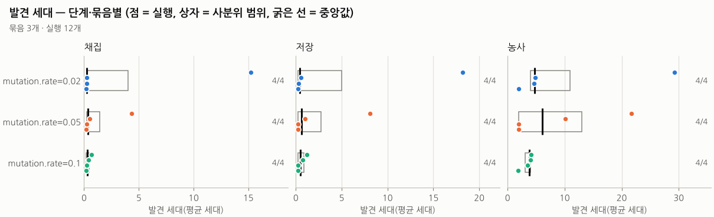

# 오프라인 분석 도구 (`tools/analyze.py`)

헤드리스 실행기(`tests/run_experiment.gd`)를 **씨앗 여러 개 · 파라미터 격자**로 돌리고, 결과 폴더들을 모아 표·보고서·그림을 만드는 파이썬 스크립트입니다. 앱(실험실 화면)에는 들어가지 않습니다 — 앱은 Godot 하나로 오프라인 동작하고, 파이썬은 "여러 번 돌려 비교하기"를 맡습니다.

- 질문 예: "돌연변이율 0.02 와 0.1 중 어느 쪽이 농사를 먼저 여나?", "이 예설정에서 멸종은 몇 번에 한 번?", "씨앗마다 발견 세대가 얼마나 흩어지나?"
- 한 실행의 이야기(지도·개체·연대기)는 실험실 화면에서, **여러 실행의 분포**는 이 도구에서 봅니다.

## 설치

```bash
pip install -r tools/requirements.txt      # numpy, pandas, matplotlib
```

Python 3.9 이상. matplotlib 이 없으면 그림만 건너뛰고 표·보고서는 만듭니다(그렇다고 안내함). godot 4.4.1 이 필요합니다(`--godot` 또는 환경 변수 `GODOT`, 기본 `godot`). 처음 한 번 `godot --headless --path . --import`. 아래 명령은 bash 기준입니다 — Windows(cmd·PowerShell)는 [Windows](#windows) 절.

## 명령

### `run` — 같은 설정, 씨앗 여러 개

```bash
python3 tools/analyze.py run --seeds 1-8 --generations 100 --preset fast_civ --out results/fast8
python3 tools/analyze.py run --seeds 1,3,5 --generations 50 --set mutation.rate=0.08 --set resources.scale=1.4 --out results/mut08
```

씨앗마다 실행기 하나를 `OUT/seed<N>/` 에 돌리고, `OUT/runs.csv` 에 결과 줄(`RESULT: …`)·종료 코드를 적은 뒤 `report` 를 부릅니다.

### `sweep` — 파라미터 격자 × 씨앗

```bash
python3 tools/analyze.py sweep --param mutation.rate=0.02,0.05,0.1 --seeds 1-4 --generations 30 --preset fast_civ --out results/mut-sweep
python3 tools/analyze.py sweep --param mutation.rate=0.02,0.1 --param resources.scale=1,1.6 --seeds 1-4 --out results/grid
```

`--param` 을 여러 번 주면 **전체 격자**(위 둘째 줄은 2 × 2 = 4칸)입니다. 칸마다 `OUT/<키=값__키=값>/seed<N>/`. 보고서는 칸(= 묶음)별로 묶습니다. `--set` 은 모든 칸에 공통으로 덮어쓰고, 같은 키를 `--param` 이 또 주면 격자 값이 이깁니다.

배열 값도 격자로 줄 수 있습니다. 괄호 안의 쉼표는 값을 나누지 않습니다(배열·사전은 JSON 이어야 하고, 괄호가 맞지 않으면 실행 전에 인자 오류). 셸이 괄호를 건드리지 않게 **큰따옴표**로 감쌉니다(bash·cmd·PowerShell 모두 됨. cmd 는 작은따옴표를 벗기지 않아 `'키=값'` 이 따옴표째 넘어오므로, 키에 따옴표가 있으면 실행 전에 인자 오류로 알립니다):

```bash
python3 tools/analyze.py sweep --param "seasons.growth=[1,1,0.5,0],[1,1,1,1]" --seeds 1-4 --out results/winter
```

### `report DIR` — 이미 있는 결과 모으기

```bash
python3 tools/analyze.py report results/mut-sweep                 # 같은 폴더에 보고서
python3 tools/analyze.py report results --out results/모두-보고서   # 여러 묶음을 한 보고서로
```

`DIR` 아래의 `summary.json` 을 모두 찾습니다(실행기를 손으로 돌린 폴더도 됨). **묶음 이름** = 실행 폴더의 부모 폴더 경로(`mutation.rate=0.1` 등). 씨앗 폴더가 `DIR` 바로 아래에 있으면(`run` 결과) 예설정 이름(+덮어쓰기)으로 짓습니다(`fast_civ`, `default+mutation.rate=0.08`).

### `ablate` — 반사실 재생(같은 스냅숏에서 설정 하나만 바꿔 견주기)

```bash
python3 tools/analyze.py ablate --runs results/base --at-gen 30 --set mutation.rate=0.2 --ticks 340 --seeds 1-12
```

씨앗마다 세 걸음입니다([`DESIGN-v0.2.md`](DESIGN-v0.2.md) 11.4).

1. **기준 실행:** `--runs` 폴더의 `seed<N>/` 에 평균 `--at-gen` 세대까지(`run` 과 같은 폴더 꼴 — 같은 설정으로 끝까지 쓴 결과가 있으면 그대로 씀). 끝 스냅숏의 틱이 F.
2. **갈래:** 그 `final.snapshot.json` 에서 두 번 이어 돌립니다 — `same/seed<N>`(그대로)와 `fork/seed<N>`(`--set` 들을 실행기 `--fork-set` 으로, `--reset-learned` 면 실행기 `--fork-reset-learned` 도). 둘 다 `--max-ticks=F+N`(`N` = `--ticks`)·`--generations=1000000000`(세대 끝 조건이 먼저 끝내지 않게)이고 `lineage.csv` 를 씁니다.
3. **표:** 창 [F, F+N) 의 지표를 견준 `ablate.csv`(씨앗·지표마다 그대로·바꿈·차이)와 `ablate.md`(지표마다 씨앗 수, 두 갈래 중앙값, 차이(바꿈 − 그대로) 중앙값 [Q1–Q3], 바꿈이 큰·작은 씨앗 수, 씨앗별 F 와 두 갈래 끝 해시). 표는 화면에도 찍습니다. 조건(`--runs`·`--preset`·`--base-set`·`--at-gen`·`--ticks`·`--set`·`--reset-learned`·씨앗)은 `ablate.json` 에 남깁니다(`baldwin` 이 읽음).

- **지표:** 출생·사망·평균 개체 수·끝 개체 수·산 틱(시계열의 틱 (F, F+N] 줄), 줍기·내려놓기·심기의 고름 %·효과 %(그 줄들의 행동 셈), 대상(틱 [F, F+N) 에 태어난 개체)의 평균 먹은 양·평균 자식 수(`lineage.csv` — 살아 있는 개체는 끝 틱까지의 값이라 수명이 창보다 길면 잘림).
- **폴더:** `--out`(기본 `<runs>-ablate/<키=값>__g<세대>__t<틱>` — 기준 실행 폴더 밖이라 `report <runs>` 에 갈래가 섞이지 않음). 갈래 폴더도 `report` 로 보고서를 만들 수 있습니다(묶음 `same`·`fork`).
- **뺀 씨앗:** 기준 실행이 그 세대 전에 멸종했거나 틱 상한에 닿은 씨앗, 갈래 실행이 실패한 씨앗은 빼고 `ablate.md` 의 "뺀 씨앗" 에 까닭을 적습니다. 갈래가 실패했으면 그 갈래의 종료 코드와 `run.log` 의 마지막 오류 줄(예: `--fork-set 으로 바꾼 설정으로 스냅숏을 열 수 없습니다: 유전체 길이가 …`)도 함께 적습니다.
- **바꿀 수 있는 키:** 저장된 배열의 길이를 바꾸지 않는 키(바꾼 설정으로 스냅숏 검사를 다시 지나야 함). `brain.hidden`·`brain.memory_units`·`map.width` 처럼 유전체 배치·기억·지도 크기를 바꾸는 키는 실행기가 종료 코드 2 로 거부하고, 그 씨앗은 실패로 기록됩니다. 학습을 켠 세계에서 `learn.eta_max` 를 개체가 가진 학습률 유전자보다 낮추는 값도 같습니다(학습률 유전자 범위 — DESIGN-v0.2 3.7). 세계를 만들 때만 읽는 키(`population.initial`·`plants.initial_fill` 등)는 바꿔도 이어 돌린 역사에 닿지 않습니다.
- **이어 돌리기:** `run` 과 같습니다. 끝까지 쓴 같은 조건의 결과는 건너뛰므로 같은 명령을 다시 주면 실행 없이 같은 표가 나옵니다. 바꾼 값·이어 돌린 스냅숏·틱 상한이 다른 이전 결과는 덮어쓰지 않고 `mismatch`(종료 코드 1).
- **이식 시험(`--reset-learned`, v0.2 1단계):** 바꾼 갈래에 실행기 `--fork-reset-learned` 를 줍니다 — 갈라질 때 살아 있는 개체의 배운 두뇌를 유전체 W2 행동 행으로, 기준선을 0 으로 되돌리고 판단 고리를 비움(DESIGN-v0.2 11.2). 보통 `--set learn.freeze=true` 와 함께 써서 바꾼 갈래 = **타고난 두뇌**(갈라진 뒤 태어난 개체도 배우지 않음), 그대로 갈래 = **배우는 두뇌**로 견줍니다. 기준 실행은 학습을 켠 세계여야 합니다(`--preset learn_basic` — 아니면 실행기가 종료 코드 2). 기본 폴더 이름에 `reset_learned` 가 붙습니다. `summary.json` 의 `reset_learned` 가 다른 이전 갈래 결과는 `mismatch`.
- **인자:** `--runs`·`--at-gen`·`--ticks` 는 꼭 필요하고, `--set 키=값`(여러 번)이나 `--reset-learned` 가운데 하나는 있어야 합니다(둘 다 없으면 바꾼 갈래가 그대로 갈래와 같아 실행하지 않고 종료 코드 2). `--seeds`(기본 `1-4`)·`--preset`(기준 실행의 예설정)·`--base-set 키=값`(기준 실행의 덮어쓰기, 여러 번 — 두 갈래 모두 이 설정에서 시작)·`--out`·`--jobs`·`--godot`·`--repo`·`--timeout` 은 `run` 과 같은 뜻.
- 두 갈래는 같은 세계·같은 난수 상태에서 갈라진 쌍입니다. 차이에는 그 설정의 직접 효과와, 행동이 달라져 갈라진 출생·먹이 고갈 같은 생태 되먹임이 함께 들어 있습니다.

### `gate-a` — 관문 A 판정(배우는 슬라임이 학습을 멈춘 같은 씨앗의 슬라임보다 잘하나)

```bash
python3 tools/analyze.py gate-a --seeds 1-12 --prereg COMMIT --out results/gate-a1-life3 --jobs 2    # 공식 A-1(= --variant A-1-life3)
python3 tools/analyze.py gate-a --variant A-2 --seeds 1-12 --prereg COMMIT --out results/gate-a2 --jobs 2   # A-2(보고)
python3 tools/analyze.py gate-a --aux --seeds 1-12 --out results/gate-a1-life3-aux  # 보조 판(판정에 쓰지 않음)
python3 tools/analyze.py gate-a --variant A-1-life --seeds 1-12 --out results/gate-a1-life   # 지난 공식(첫 판정·재판정 — 대상 [200, 600))
python3 tools/analyze.py gate-a --variant A-1 --seeds 1-12 --out results/gate-a1     # 처음 정의(공식 아님)
python3 tools/analyze.py gate-a --seeds 25-36 --prereg COMMIT --out results/gate-a1-life3-25-36 --jobs 2   # 3차 판정(씨앗 규율 — 아래)
```

`COMMIT` 자리에는 사전 고정 커밋(판정 문턱·지표를 판정 실행 전에 고정한 커밋 — `git log` 의 'v0.2 관문 A(1)' 해시, 재조정 뒤의 재판정은 'v0.2 관문 A 재조정(3)' 해시, 3차 판정은 'v0.2 관문 A 3차(3)' 해시)을 씁니다. [`DESIGN-v0.2.md`](DESIGN-v0.2.md) 14.3 의 관문 A 입니다. A-1 계열은 씨앗마다 우연 기준 세계(`chance_baseline` + `learn.enabled=true` + `body.grow_enabled=true`)를 틱 0 부터 세 갈래로 돌립니다 — `learn/seed<N>`(학습, `learn.freeze=false`), `freeze/seed<N>`(학습을 멈춤 — 학습 비용은 냄), `off/seed<N>`(학습 끔 — 비용까지 뺀 셋째 행, `learn.enabled=false`). 모두 `lineage.csv` 를 쓰고 세대 끝 조건은 큰 값입니다. **대상** = 변형의 대상 출생 구간(공식 `A-1-life3` 은 틱 [0, 600) — `GATE_A3_BIRTH_WINDOW`, 지난 공식 `A-1-life`·처음 정의 `A-1` 은 [200, 600) — `GATE_A_BIRTH_WINDOW`)에 태어난 개체(처음 개체 제외)이고, 대상의 평생 먹은 양·**평균 산 나이**(죽은 나이 `death_tick − birth_tick` 의 평균)·자식 수, 그리고 보고만 하는 성숙까지 산 몫(죽은 나이 > `repro.maturity` — 번식 자격 나이로 번식 단계에 살아서 닿음)을 견줍니다.

- **변형(`--variant`, 기본 `A-1-life3`):**
  - `A-1-life3`: **공식 A-1**(3차 판정부터 — 사용자 결정 2026-10-17, 상수 `GATE_A_OFFICIAL`, DESIGN-v0.2 14.3 '3차 판정(씨앗 25~36)'). `A-1-life` 와 같은 세계·갈래·문턱·판정 불가 규칙에서 **대상만 처음 개체가 아닌 틱 [0, 600) 출생**(첫 자식 무리 전체 — 시작 경계 앞에 출생이 없어 학습이 출생 시점을 옮겨도 갈래마다 다른 몫이 들어가지 않음, TEST-REPORT "v0.2 관문 A 3차 준비" 1·3절).
  - `A-1-life`: 첫 판정·재판정의 **지난 공식 A-1**(사용자 결정 2026-10-11 — 기록 재현을 위해 그대로 둠, 대상 [200, 600)). A-1′ 세계(`population.initial` 400·`population.cap` 400·`plants.initial_fill` 1.0)에서 생존 틱 요구 없이, 두 판정 갈래(학습·freeze) 모두 대상 ≥ 30 이면 판정하고, 대상이 모두 죽을 때까지(또는 멸종까지 — 최대 1,500틱) 돌립니다. 끝에 살아 있는 대상이 있으면(평생 값이 잘림) 그 씨앗은 판정 불가. 한 씨앗이라도 판정 불가면 **판정 불가**.
  - `A-1`: 처음 정의(공식 아님 — 0단계 미리 보기에서 판정 불가로 보여 바꿈). 1,000틱까지 돌리고, 두 판정 갈래가 모두 1,000틱까지 살고 대상이 30 이상이어야 그 씨앗을 판정합니다.
  - `A-2`: 진화한 두뇌(보고 — 관문 A 의 필수 조건 아님). 씨앗마다 ① `base/seed<N>` 에 `learn_basic` 을 평균 30세대까지(끝 스냅숏의 틱 = F, `lineage.csv` 없음), ② 그 `final.snapshot.json` 에서 `learn/seed<N>`(학습 — 그대로 이어 돌림)·`freeze/seed<N>`(`--fork-set=learn.freeze=true`)을 `--max-ticks=F+340` 까지, 기준 행 `chance/seed<N>` = 같은 씨앗의 우연 기준 세계(`chance_baseline` + `learn.enabled=true` + `body.grow_enabled=true` — `learn_basic` 과 유전만 다름)를 틱 0 부터 `--max-ticks=F+340` 까지, ③ 대상 = 틱 [F, F+100) 출생. 기준 실행이 30세대 전에 끝난(멸종·틱 상한) 씨앗은 갈래를 돌리지 않고 판정 불가. A-2 는 판정 불가 씨앗이 있어도 남은 씨앗으로 문턱을 셉니다(문턱 수는 씨앗 12개 기준 그대로 — 판정 불가 씨앗은 높은 씨앗으로 세지 않음). 기준 행은 F+340 전에 멸종했거나 대상 < 30·끝에 산 대상이 있으면 그 씨앗에서 '없음'.
- **판정 문턱(`analyze.py` 상수 `GATE_A_*` — 명령 인자로 바꿀 수 없고 보고서 머리에 그대로 인쇄):** ① 먹은 양 — 대상 먹은 양 중앙값이 학습 쪽에서 높은 씨앗 ≥ 10(`GATE_A_WIN`), 그리고(A-1 만) 씨앗들의 대상을 묶은 중앙값 비(학습 ÷ freeze) ≥ 1.05(`GATE_A_RATIO` — A-2 는 비를 보고만). ② 생존·번식 — 평균 산 나이나 평균 자식 수(`GATE_A_SECONDARY`) 가운데 하나가 학습 쪽에서 높은 씨앗 ≥ 8(`GATE_A_SECONDARY_WIN`, 지표마다 셈). 둘 다 채우면 **통과**, 아니면 **실패**. 같으면 높은 쪽으로 세지 않습니다. ② 의 생존 지표는 처음에 '성숙까지 산 몫' 이었지만, 기본값에서는 이 몫이 세 갈래 모두 1 이라(자식이 부모에게 받은 에너지만으로 성숙 나이 30틱보다 오래 삶 — 1단계 검증) 갈래를 가르지 못해 판정 실행 전에 평균 산 나이로 바꿨습니다(사전 결정 2026-10-11, DESIGN-v0.2 14.3). 성숙까지 산 몫은 표에 보고만 합니다. 보고서는 판정 가능 씨앗 모두에서 학습 = freeze 인 지표를 "판정" 절에 **갈래를 가르지 못한 지표** 로 적습니다. 문턱은 씨앗 12개(`GATE_A_SEEDS`) 기준이라 씨앗 수가 다르면 값만 적고 **판정 안 함**. 판정은 실행 전에 정한 씨앗으로만 하고, 값·키·정의를 고친 뒤의 다시 판정은 조정에 쓰지 않은 새 씨앗(재판정 13~24, 3차 25~36)으로 합니다(14절 판정 규칙).
- **사전 고정(`--prereg COMMIT`):** 보고서 머리에 '사전 고정' 줄을 씁니다 — 그 커밋의 해시·제목과, 지금 도는 `tools/analyze.py` 가 그 커밋의 것과 같은지(그 커밋의 blob 해시 = 지금 파일의 `git hash-object`, 줄 끝 변환 설정을 따름). 다르면 **다름**(사전 고정대로의 판정이 아님). git 이 없거나 저장소 밖·없는 커밋이면 '확인 못 함', 주지 않으면 '주지 않음'. 판정 문턱은 바꾸지 않습니다.
- **씨앗 규율(3차 판정 — 사용자 결정 2026-10-17, DESIGN-v0.2 14.3 '3차 판정(씨앗 25~36)'):** 3차 판정 씨앗 25~36(`GATE_A_JUDGE_SEEDS`)은 `--seeds 25-36` 으로 12개를 함께(다른 씨앗 없이), 사전 고정의 변형(`GATE_A_JUDGE_VARIANTS` — 공식 `A-1-life3`(`--aux` 보조 판 포함)·`A-2`)으로, `--prereg COMMIT` 을 주고, 실행을 정하는 파일(`GATE_A_FROZEN_PATHS` — `project.godot`·`config/`·`scripts/`·`tests/run_experiment.gd`·`tools/analyze.py`)이 그 커밋과 바이트까지 같고(파일마다 그 커밋의 blob 해시 = 지금 파일의 `git hash-object` — 인덱스를 믿지 않음. 그 커밋에 없던 새 파일·지운 파일도 '다름', `.gitignore` 로 무시하는 `.godot/` 만 뺌), 지금 도는 `analyze.py` 가 `--repo` 의 것과 같을 때만 돌립니다. 어기면 아무것도 돌리지 않고 결과 폴더도 만들지 않고 `오류: 씨앗 규율 — …` 와 종료 코드 2. 판정 씨앗으로 돈 보고서 머리에는 '씨앗 규율' 줄(변형 이름 포함)이 붙습니다. 그 밖의 씨앗(조정용 1~12, 지난 판정 씨앗 13~24 — `GATE_A_SPENT_SEEDS` 1~24 는 이제 판정 씨앗이 아니라 판정 가능성 확인에 다시 돌려도 됨, 도구 확인 101 이상)은 거르지 않고 보고서도 바뀌지 않습니다(판정 계산은 그대로). 재판정 때의 재판정 씨앗(13~24)·예비 씨앗(25~36) 상수는 없앴고 예비 씨앗은 없습니다. `run`·`sweep`·`ablate`·감싼 스크립트는 거르지 않으므로 그것으로 25~36 을 돌리지 않는 것은 규율입니다. 25~36 은 사전 고정의 세 명령으로 한 번만 돌립니다 — 도구는 새 사전 고정 커밋을 주면 다시 돌리는 것을 막지 않으므로 이것도 규율입니다. 지난 재판정(2026-10-11, 13~24)은 그때의 장치(커밋 `a51b4f2`)로 돌았습니다(TEST-REPORT "v0.2 관문 A 재조정" 4·5절).
- **보고서(`gate_a.md`, 14.3 의 보고 꼴):** 지표마다 쓰임(①·②·보고), 세 행(학습·freeze·셋째 행 — A-1 계열은 학습 끔, A-2 는 우연 기준. 판정 가능 씨앗의 대상을 묶은 값: 먹은 양은 중앙값, 나머지는 평균)과 두 차이(학습 − freeze = 학습이 한 몫, 학습 − 셋째 행), 효과 크기 (학습 − freeze) ÷ freeze, 학습 쪽이 높은 씨앗 수. 셋째 행은 그 갈래도 조건(대상 ≥ 30·끝에 산 대상 없음 — A-2 기준 행은 F+340 까지 생존도)을 채운 씨앗만 묶고 세며, 못 채운 씨앗은 따로 적습니다. 그 아래 씨앗·갈래별 표와 판정 불가 씨앗의 까닭. 씨앗·갈래마다 값은 `gate_a.csv`(`seed, branch, status, birth_lo, birth_hi, end_reason, ticks, extinct_tick, targets, targets_alive, eaten_median, eaten_mean, life_mean, children_mean, matured_share, history_hash` — `birth_lo`·`birth_hi` = 대상 출생 틱 [lo, hi)).
- **보조 판(`--aux`):** 학습·freeze 갈래를 `learn.diag_factor=none` 으로(14.3 — 보고만, 판정에 쓰지 않음). A-1 계열만이고 `A-2` 와 함께 주면 종료 코드 2. 다른 `--out` 을 주세요.
- **알려진 표기(고칠 후보 — 사전 고정 코드라 판정 뒤 따로):** 갈래 상태 '생존 틱 전 멸종'(`GATE_A_RUN_STATUS_KO["extinct"]`)은 A-1 계열과 A-2 가 같이 쓰는 낱말이라, 생존 틱 요구가 없는 A-2 의 기준 행에서는 'F + 340 전 멸종' 이라는 뜻입니다(TEST-REPORT "v0.2 관문 A 판정" 절 6·12절). 판정 통계에는 영향이 없습니다.
- **이어 돌리기:** `run` 과 같습니다(같은 조건의 끝까지 쓴 결과는 건너뛰므로 같은 명령이면 실행 없이 같은 보고서). 실패한 실행이 있으면 그 씨앗은 판정 불가이고 종료 코드 1. 판정 결과(통과·실패·판정 불가)와 상관없이 보고서를 쓰면 0. **'같은 조건' 은 예설정·`--set`·세대·틱 상한(과 `--fork-set`·이어 돌린 스냅숏·`reset_learned`)만 대조합니다** — `config/` 의 기본값(예: `learn.*`)이 바뀐 뒤에도 옛 결과를 그대로 세고, 씨앗 규율 장치도 `--out` 이 비었는지 보지 않습니다. 판정 실행은 **없는(새) `--out`** 으로 돌리세요(DESIGN-v0.2 14.3 '3차 판정' 7 — TEST-REPORT "v0.2 관문 A 3차 준비" 6절 V3-05).
- 두 판정 갈래는 같은 씨앗의 같은 처음 세계(A-2 는 같은 스냅숏)에서 설정 하나만 다른 쌍입니다. 행동이 달라지면 출생·먹이 고갈·난수 뽑기도 갈라지므로, 차이에는 학습이 바꾼 생태 되먹임도 들어 있습니다.
- 시간: 이 컨테이너에서 씨앗 하나(갈래 셋, 2개씩 병렬)가 `A-1` 약 6초, `A-1-life` 약 9초였습니다(작은 시험 실행 — 판정 표는 만들지 않음). `A-2` 는 [`TEST-REPORT.md`](TEST-REPORT.md) "v0.2 관문 A — 사전 고정" 절. 씨앗 1~12 판정 실행(2개씩 병렬)은 `A-1-life` 1분 23초·보조 판 1분 21초·`A-2` 2분 43초였습니다("v0.2 관문 A 판정" 절).

### `baldwin DIR` — 볼드윈 보고서(η·배운 양·동화 지수의 세대 추이와 이식 시험)

```bash
python3 tools/analyze.py run --seeds 1-12 --generations 100 --preset learn_basic --lineage --out results/learn
python3 tools/analyze.py ablate --runs results/learn-g10 --preset learn_basic --at-gen 10 --reset-learned --set learn.freeze=true \
                                --ticks 340 --seeds 1-12 --out results/probe-g10
python3 tools/analyze.py ablate --runs results/learn-g30 --preset learn_basic --at-gen 30 --reset-learned --set learn.freeze=true \
                                --ticks 340 --seeds 1-12 --out results/probe-g30
python3 tools/analyze.py ablate --runs results/off-g30 --at-gen 30 --set learn.freeze=true --ticks 340 --seeds 1-12 --out results/control-g30
python3 tools/analyze.py baldwin results/learn --probe results/probe-g10 --probe results/probe-g30 --control-probe results/control-g30
```

[`DESIGN-v0.2.md`](DESIGN-v0.2.md) 11.2 의 보고 항목입니다(관문 아님). 결과는 `DIR`(또는 `--out`)의 `baldwin.md`·`baldwin.csv`.

- **세대 추이:** `DIR` 아래 학습을 켠 실행(`summary.json` 의 `features` 에 `learn.enabled`)의 `lineage.csv` 에서, 개체 세대 10세대 폭마다 **죽은 개체**(평생 값이 정해짐)의 η 평균(계통 `eta` — 태어날 때 학습률 유전자 8개의 평균), 배운 양 `dw`(64 행동 가중치의 abs(배운 − 타고난) 평균), 어린 동안 배운 양 `dw_juv`(어린 동안 모든 갱신에서 움직인 양의 합 — `dw` 와 단위가 달라 수십 배 큼, DESIGN-v0.2 9.4), 동화 지수 `assim`(평균), 먹은 양(중앙값), 자식 수(평균). 보고서 표는 묶음마다 실행 값의 중앙값입니다. `baldwin.csv` 열: `cell, seed, path, gen_lo, gen_hi, dead, eta_mean, dw_mean, dw_juv_mean, assim_mean, eaten_median, children_mean`. 학습을 켜지 않았거나 `lineage.csv`(묶음 기본은 `--no-lineage` — `--lineage` 로 돌리세요)가 없는 실행은 빼고 까닭을 적습니다.
- **같은 실행의 첫 구간 → 끝 구간:** 실행마다 죽은 개체가 30(`BALDWIN_MIN_DEAD`) 이상인 첫 세대 구간과 끝 구간을 견줘 지표마다 내린 실행 · 오른 실행을 셉니다(끝 세대 구간은 앞서 간 몇 계통뿐이라 개체가 적음).
- **이식 시험(`--probe`, 여러 번):** `ablate --reset-learned --set learn.freeze=true` 의 결과 폴더. 폴더마다(평균 세대 `--at-gen` 순) 대상 평균 먹은 양·자식 수의 배우는 두뇌(그대로 갈래) 대 타고난 두뇌(바꾼 갈래) 씨앗 중앙값과 차이, 배우는 쪽이 큰 씨앗 수. `ablate.json` 이 없거나 `reset_learned` 가 거짓인 폴더는 빼고 까닭을 적습니다. 평균 세대마다 다른 `--runs` 폴더를 쓰세요(`ablate` 의 기준 실행은 `--runs/seed<N>` 에 그 세대까지 돌린 결과).
- **학습 끈 대조(`--control-probe`, 여러 번):** 학습을 끈 실행에서 같은 평균 세대·틱으로 돌린 `ablate` 결과의 그대로 갈래 = 학습 없이 진화한 두뇌의 능력. 같은 평균 세대의 이식 시험의 타고난 능력과 같은 씨앗끼리 견줍니다(`--set` 은 아무 키 — 그대로 갈래만 읽음).
- **동화·감춤(결과 그대로):** 동화 = η 가 줄고(첫 → 끝 구간에서 내린 실행이 과반), 동화 지수가 오르고(오른 실행이 과반), 이식 시험의 타고난 능력이 가장 이른 → 가장 늦은 평균 세대에서 오름(오른 씨앗이 과반) — 셋 모두. 감춤 = 가장 늦은 평균 세대에서 타고난 능력 < 학습 끔인 씨앗이 과반(Mayley 1997). 자료가 모자라면 "판단할 자료 없음". 통계 검정은 아닙니다. 행동 행별 η 는 기록 열에 없어(계통 `eta` 는 8행 평균) 보고하지 않습니다.

### 인자

| 인자 | 기본 | 뜻 |
|---|---|---|
| `--seeds` | `1-4` | `1-8`, `1,3,5`, `1-3,7` (겹치면 한 번, 오름차순) |
| `--generations` | `100` | 목표 평균 세대(실행기 `--generations`). 0 보다 큰 10진수·지수 표기(`100`, `2.5`, `1e3`)만 — 실행기가 받지 않는 꼴(`1_0` 등)은 실행 전에 인자 오류 |
| `--preset` | `default` | `config/presets.json` 이름 |
| `--set 키=값` | — | 설정 덮어쓰기, 여러 번. 값은 실행기가 해석(`[1,1,0.5,0]` 같은 배열도 됨) |
| `--param 키=v1,v2` | — | `sweep` 전용, 여러 번 → 격자. 배열 값은 `[..],[..]`(괄호 안 쉼표는 나누지 않음) |
| `--jobs N` | min(4, CPU 수) | 동시에 돌릴 실행기 수 |
| `--godot` | `$GODOT` 또는 `godot` | godot 실행 파일. 경로(`./godot`, `bin/godot`)는 **지금 셸 위치** 기준(`--out`·`--repo` 와 같음 — 실행기는 저장소 폴더에서 돌지만 절대 경로로 바꿔 넘김), 이름만 주면 PATH 에서 찾음 |
| `--repo` | `tools/` 의 부모 | 저장소 위치 |
| `--out` | (필수) | 결과 폴더 |
| `--lineage` / `--no-lineage` | `--no-lineage` | 묶음에서는 `lineage.csv`(1,000세대면 8MB)를 기본으로 쓰지 않음 |
| `--max-ticks` | 설정값 | 틱 상한 — 실행기와 같은 1~1,000,000,000(`SimConfig.TICK_MAX`)의 정수, 밖이면 인자 오류(2) |
| `--timeout` | `3600` | 실행 하나의 시간 제한(초). 넘으면 그 실행만 끝내고 `timeout` 으로 기록 |
| `--no-report`, `--no-plots` | — | 보고서 / 그림 끄기 |
| `--lang` | `auto` | 그림 문구 `ko`·`en`. `auto` 는 나눔고딕(`assets/fonts`)을 쓸 수 있으면 한국어 |

**이어 돌리기:** 끝까지 쓴 결과가 이미 있는 씨앗 폴더는 건너뜁니다. 같은 명령을 다시 주면 실패·중단된 것만 다시 돌립니다(`runs.csv` 의 이전 성공 줄은 그대로 둠). "끝까지 쓴 결과" = `summary.json` 이 읽히고 역사 해시가 있으며 `write_failed` 가 비었고 `timeseries.csv`·`chronicle.csv`·`final.snapshot.json` 이 비어 있지 않게 있는 것. 실행기는 쓰다가 실패해도(종료 코드 3) `summary.json` 을 남길 수 있으므로, 이 조건을 못 채우거나 `runs.csv` 의 이전 상태가 `failed`·`timeout`·`error` 이면 `summary.json` 이 있어도 **다시 돌립니다**(`다시 돌림(까닭)` 출력 — 실행기가 그 폴더의 앞 결과 파일을 지우고 새로 씀). 건너뛰기 전에 그 결과의 예설정·목표 세대·덮어쓰기·**틱 상한**(실행기가 `summary.json` 의 `max_ticks` 에 실제로 쓴 상한, 이번 요청은 `--max-ticks` 또는 설정의 `run.max_ticks`)을 이번 요청과 비교해, 다르면 덮어쓰지 않고 경고와 함께 `mismatch` 로 기록합니다(보고서의 실패 표에 나옴). 예: `--max-ticks 2000` 으로 시험한 폴더에 상한 없는 본 실행을 주면 잘린 결과를 쓰지 않고 알립니다(`max_ticks` 기록이 없는 예전 결과는 설정값으로 봅니다). 설정을 바꿨으면 다른 `--out` 을 쓰세요. 종료 코드: 모두 성공 0, 실패·mismatch 가 있으면 1, 인자·저장소 오류 2.

## 결과 파일

```
OUT/
  runs.csv                 실행 기록: cell, seed, status(ok·failed·timeout·error·existing·mismatch), exit_code, wall_seconds, result(RESULT 줄), out_dir, command
  summary.csv              실행마다 한 줄 (아래)
  cells.csv                묶음마다 한 줄 (아래)
  report.md                한국어 보고서(표 + 그림 + 읽는 법)
  actions.csv              구간별 문명 행동 셈(행동 셈 열이 있는 실행이 있을 때 — 아래)
  eaten.csv                개체 세대별 평생 먹은 양(lineage.csv 에 eaten 이 있는 실행이 있을 때)
  population.png  mean_gen.png  traits.png  civ_stage.png  discovery.png
  seed1/  …                실행기 결과(summary.json, timeseries.csv, chronicle.csv, final.snapshot.json) + run.log
```

씨앗 폴더의 실행기 결과 파일(`timeseries.csv`·`chronicle.csv`·`lineage.csv`·`summary.json`·스냅숏)의 열 뜻·구간 값과 누적 값·틱 기준(진행 중인 틱 번호와 진행한 뒤 틱)·`death_cause` 같은 코드는 [`DESIGN-v0.1.md`](DESIGN-v0.1.md) 8.3·8.4 가 정본입니다(v0.2 에서 더한 스냅숏 키와 끝에 붙인 열 — 행동별 고른·효과 횟수 `act_*`·`eff_*`, 평생 먹은 에너지 `eaten` — 은 [`DESIGN-v0.2.md`](DESIGN-v0.2.md) 9.1·9.3·9.4). 아래는 `analyze.py` 가 만드는 표입니다.

`summary.csv`·`cells.csv`·`runs.csv` 는 **BOM 붙은 UTF-8** 입니다 — 한국어 Windows 엑셀이 두 번 클릭으로 열어도 `civ_stage_name`(농사)·`result` 의 한글이 깨지지 않습니다(BOM 이 없으면 엑셀은 시스템 코드 페이지 cp949 로 읽음). pandas(`pd.read_csv`)·파이썬 `csv`(`encoding="utf-8-sig"`)·LibreOffice 는 그대로 읽고, R 은 `read.csv(파일, fileEncoding = "UTF-8-BOM")`. 실행기·실험실이 쓰는 `timeseries.csv`·`chronicle.csv`·`lineage.csv` 도 BOM 붙은 UTF-8 입니다(같은 규칙 — 엑셀 두 번 클릭, pandas 는 그대로, R 은 위와 같이. `summary.json`·스냅숏 같은 JSON 에는 BOM 을 붙이지 않음). `analyze.py` 는 BOM 이 있어도 없어도 읽습니다.

**`summary.csv`** (BOM 붙은 UTF-8, 쉼표, 영문 열 이름, 빈 값 `NaN`):

| 열 | 뜻 |
|---|---|
| `cell`, `seed`, `preset`, `overrides`, `generations_target` | 묶음, 씨앗, 예설정, 실제 덮어쓰기(`키=값;…`), 목표 세대. 스냅숏에서 이어 돌린 실행(실험실에서 스냅숏을 연 실험도)은 예설정을 알 수 없어 `preset` 이 비고 `overrides` 도 비며, 루트 바로 아래면 묶음 이름이 `snapshot` |
| `end_reason` | `generations`(목표 도달) · `extinction` · `max_ticks` |
| `ticks`, `mean_generation`, `population`, `peak_population`, `births`, `deaths` | 끝날 때 값(`summary.json` — `births`·`deaths` 는 누적 `total_births`·`total_deaths`). 단 **멸종한 실행의 `mean_generation`** 은 빈 개체의 평균(0)이 아니라 살아 있던 마지막 시계열 줄(멸종 최대 20틱 전)의 평균 세대(`final_mean_size` 와 같은 방식, 시계열이 없으면 NaN) |
| `civ_stage`, `civ_stage_name` | 끝날 때 문명 단계 0~3(없음·채집·저장·농사) |
| `extinct_tick`, `storehouses`, `farms` | 멸종 틱(-1 없음), 저장고·밭 수 |
| `disc_tick_forage` · `disc_gen_forage` (`_store`, `_farm`) | 채집(저장·농사) **발견 틱(-1)·발견 세대(NaN = 발견 못 함)**. 발견 틱은 발견한 틱 번호(진행 중인 틱 — 시계열에는 다음 줄부터 보임, DESIGN 8.4) |
| `final_mean_size`, `final_mean_sense` | 살아 있던 마지막 기록의 평균 크기·감지 반경(`timeseries.csv` 의 `mean_sense` — 반올림한 반경의 평균이라 `lineage.csv` 의 `sense` 유전자 평균과 다름) |
| `window_births` | 틱 [200, 600) 에 태어난 개체 수(처음 개체 빼고 — DESIGN-v0.2 14.3 의 관문 A-1 대상 구간). `lineage.csv` 가 없으면 `NaN` |
| `run_seconds`, `history_hash`, `path` | 실행기 시간, 역사 해시(64자), 실행 폴더(상대 경로) |

**v0.2 0단계 열(행동 셈 `act_*`·`eff_*`, 계통 `eaten`)이 있으면** 보고서에 세 절이 더해집니다. 열이 없는 예전 결과도 그대로 읽고, 그 절만 "없음" 으로 적거나 뺍니다. 어떤 열이 있는지는 실행마다 `summary.json` 의 `timeseries_columns`(0단계부터 실행기·실험실이 씀)를 먼저 보고, 없으면 CSV 머리로 봅니다. 도구 안의 손 사본(`TIMESERIES_COLUMNS`·`STAGE_NAMES_KO` 등)은 `test_analyze.py` 의 `TestHandCopies` 가 시뮬레이션 상수와 견줍니다.

- **행동 비율(act/eff)** — `actions.csv`(열 `cell, seed, path, basis, bin_lo, bin_hi, action, rows, total, act, eff, act_share, eff_share, success`): 실행·구간·문명 행동(줍기·내려놓기·심기)마다 고른 횟수 `act`, 효과가 난 횟수 `eff`(효과의 뜻은 DESIGN-v0.2 11.1), 그 구간 모든 행동 수 `total`, `act_share` = act ÷ total, `eff_share` = eff ÷ total, `success` = eff ÷ act. 시계열 한 줄은 앞 줄 뒤 그 줄까지의 구간이고, 줄을 구간 **시작** 값(앞 줄)으로 나눕니다. `basis = gen`: 시작 평균 세대 10세대 폭, 그 행동이 열린 뒤(줍기·내려놓기 = 채집, 심기 = 농사)에 시작한 줄만. `basis = tick`: 처음 1,000틱의 200틱 폭, 열림과 상관없이 모든 줄(수백 틱 만에 멸종할 수 있는 우연 기준과 같은 틱에서 견줌). 보고서 표는 묶음마다 실행 값의 중앙값(괄호 = 실행 수). 세대 구간의 묶음 중앙값은 구간마다 값이 있는 실행이 달라(일찍 열린 씨앗만 앞 구간에 있음) 구간끼리 견주면 씨앗 구성의 차이가 섞이므로, 보고서는 **같은 실행의 첫 구간 → 끝 구간** 표(묶음·행동마다 고름·효과·성공률이 내린 실행 수 · 오른 실행 수, 괄호 = 구간이 둘 이상이라 견준 실행 수)를 함께 냅니다. 세대에 따른 방향은 이 표로 읽습니다.
- **평생 먹은 양** — `eaten.csv`(`cell, seed, path, gen_lo, gen_hi, dead, eaten_median, eaten_mean`, `lineage.csv` 가 있을 때 — 묶음 기본은 `--no-lineage`): 실행·개체 세대 10세대 폭마다 죽은 개체의 수·먹은 양 중앙값·평균. v0.1 스냅숏(개체별 먹은 양이 없음)에서 `--resume` 한 실행은 연 틱 전에 태어난 개체의 `eaten` 칸이 비어 있고(평생 값을 모름 — DESIGN-v0.2 9.4), 그런 개체는 빼고 셉니다.
- **관문 A-1 판정 가능성(미리 보기)** — `summary.csv` 의 `window_births` 와 멸종 틱으로, DESIGN-v0.2 14.3 의 A-1 이 그 묶음에서 판정 가능한지(씨앗마다 1,000틱까지 살고 대상 출생 30 이상) 셉니다. `lineage.csv` 가 있는 실행이 있을 때만.

**`cells.csv`**: `runs`, `extinct`·`extinction_rate`, `reached_<단계>`·`reach_rate_<단계>`(끝 단계가 그 이상인 실행 수·비율), `disc_gen_<단계>_n/_median/_q1/_q3/_iqr`(도달한 실행만), `mean_generation_median`, `ticks_median`, `population_median`, `peak_population_median`, `final_mean_size_median`, `final_mean_sense_median`, `run_seconds_median`, `run_seconds_total`.

## 그림

모두 실행마다 얇은 선(또는 점) 하나이고, 색 = 묶음(고정 순서 8색). 묶음이 8개를 넘으면 색을 돌려쓰지 않고 **묶음마다 작은 그림**(가로 4칸씩)으로 나눕니다(특성 그림은 `traits_mean_size.png`·`traits_mean_sense.png` 두 장). 묶음이 둘 이상이면 아래에 범례, 하나면 부제에 이름.

| 파일 | 보이는 것 |
|---|---|
| `population.png` | 개체 수 대 틱. 멸종한 실행은 끝에 ×. 상한(`population.cap`, 기본 250)에 붙은 구간은 먹이가 아니라 상한이 개체 수를 정함 |
| `mean_gen.png` | 평균 세대 대 틱. 기울기 = 세대 교체 속도 |
| `traits.png` | 평균 크기(왼쪽)·평균 감지 반경(오른쪽, 반올림한 칸 수의 평균) 대 평균 세대. 개체 0 인 줄(평균 열이 0.0)은 뺌. 거의 변하지 않을 때 잡음이 커 보이지 않게 세로 범위를 최소 0.2·1.0 으로 둠 |
| `civ_stage.png` | 문명 단계 계단선 대 평균 세대. 겹치지 않게 실행마다 세로로 조금씩 띄움. 멸종한 실행은 끝에 × |
| `discovery.png` | 단계(채집·저장·농사)마다 한 칸, 세로 = 묶음. 점 = 실행, 회색 상자 = 사분위 범위(실행 3개 이상), 검은 선 = 중앙값, 오른쪽 = 도달 수/전체 |

## 발견 세대는 이렇게 계산합니다

1. 실행의 `chronicle.csv` 에서 `kind = discovery` 인 줄을 찾습니다. 시뮬레이션이 발견 순간에 `mean_gen`(평균 세대, 0.01 단위로 반올림)을 함께 적습니다 — 채집·농사는 그 틱을 진행한 뒤 살아 있는 개체, 저장은 진행 전 개체의 평균입니다(행동 도중에 열리므로, DESIGN 8.4 "틱 기준").
2. 단계는 문장 머리 `채집 발견 — …`·`저장 발견 — …`·`농사 발견 — …` 로 가립니다. 머리가 다르면(문구가 바뀐 경우) `summary.json` 의 `discovery_ticks` 와 **같은 틱**의 사건으로 맞춥니다.
3. 연대기가 없거나 사건이 빠졌는데 `summary.json` 에 발견 틱이 있으면, `timeseries.csv` 의 평균 세대를 그 틱으로 선형 보간합니다(근사).
4. 발견하지 못한 단계는 틱 -1, 세대 `NaN`. 묶음 통계(중앙값·사분위)는 **도달한 실행만**으로 계산하고, 도달 비율을 따로 적습니다.

사분위는 numpy 기본(선형 보간) 백분위수입니다.

## 주의

- **시간:** 기본 설정에서 실행 하나가 세대당 약 110틱이고, 속도는 기계에 따라 평균 약 150~250틱/초 → **세대당 약 0.45~0.73초**(1,000세대 ≈ 7.4분(2단계 기계)~12.2분(검토 고침 날 4코어 공유 기계) — `docs/TEST-REPORT.md`, `docs/DESIGN-v0.1.md` 13절). 전체 ≈ 묶음 수 × 씨앗 수 × 세대 × 세대당 시간 ÷ `--jobs`. CPU 코어보다 `--jobs` 를 크게 주면 빨라지지 않습니다. 아래 예시의 `run`(`fast_civ` 100세대 씨앗 8개)은 그 공유 기계에서 `--jobs 3` 으로 114초(실행 하나 3.3~61.3초 — 일찍 멸종한 씨앗 1·7 은 짧음), `sweep`(12개 × 60세대)은 84초였습니다.
- **`run_seconds`** 는 동시에 돌던 다른 실행과 CPU 를 나눈 시간입니다. 성능 비교에는 `--jobs 1` 로.
- **결정성:** 같은 씨앗·같은 설정·같은 코드면 역사 해시가 같습니다(병렬로 돌려도). 같은 결과 폴더로 `report` 를 다시 만들면 `summary.csv`·`cells.csv`·`report.md` 는 바이트까지 같습니다(검사함. `summary.csv`·`cells.csv` 는 pandas 2.2 와 3.0 사이에서도 같음을 확인). 실행을 다시 돌리면 `run_seconds` 만 달라집니다. 해시가 다르면 설정이나 코드가 다른 것입니다.
- **중도 절단:** 목표 세대에서 멈추므로, 그보다 늦게 올 발견은 "도달 못 함"으로 셉니다. 늦은 단계를 비교할 때는 목표 세대를 넉넉히.
- **평균 세대는 단조롭지 않을 수 있습니다**(나이 많은 고세대 개체가 한꺼번에 죽으면 잠깐 내려감). 문명 단계 그림의 가로축이 잠깐 뒤로 가는 것은 그 때문입니다.
- 결과 폴더를 저장소 안(`results/…`, git 에서 무시됨)에 두어도 Godot 가 CSV(번역 표로)·PNG(텍스처로)를 가져오지 않게, 실행기는 씨앗 폴더에, `analyze.py` 는 자기가 쓰는 폴더(`run`·`sweep` 의 `--out`, `report --out`)에 빈 `.gdignore` 를 넣습니다. Godot 은 `.gdignore` 가 있는 폴더의 하위 폴더도 모두 건너뜁니다.
- 묶음 순서는 폴더 이름의 자연 순서입니다(숫자 덩어리는 수로: `rate=0.02` < `rate=0.1`, `trial-2` < `trial-10`). `-` 는 이름 맨 앞이나 `=` 바로 뒤에서만 음수 부호(`rate=-0.5` < `rate=0.1`)이고, 그 밖에서는 구분자입니다.
- 실행기 출력(`RESULT:` 줄의 한글 등)은 OS 의 코드 페이지와 무관하게 UTF-8 로 읽고, `analyze.py` 자신의 출력(진행 줄·안내)도 UTF-8 로 씁니다 — Windows 는 출력을 파일·파이프로 돌리면(`> log.txt`, CI) ANSI 코드 페이지(cp949·cp1252)를 strict 로 써서 `—`·한글에서 죽었으므로 시작할 때 표준 출력·오류를 UTF-8 로 다시 설정합니다(`PYTHONUTF8` 없이도 됨. 콘솔 창에서는 원래대로 보임).
- 씨앗 4개 정도의 사분위 범위는 거칩니다. 결론을 내기 전에 씨앗을 늘리세요.

## 예시 (`docs/analysis/example/`)

이 저장소에 함께 올린 작은 예시입니다(원본 실행 폴더는 올리지 않음, 보고서·표·그림만). 아래 두 명령으로 만든 `results/example-run/`·`results/example-sweep/` 의 `report.md`·`summary.csv`·`cells.csv`·`*.png` 를 그대로 `docs/analysis/example/run/`·`sweep/` 에 복사한 것입니다 — 다시 돌리면 `run_seconds`(보고서의 시간 열)만 다르고 나머지는 같습니다(검사: `test_analyze.py` 가 보고서의 결과 폴더 이름이 이 명령의 `--out` 과 같은지 봄).

```bash
python3 tools/analyze.py run   --seeds 1-8 --generations 100 --preset fast_civ --out results/example-run --jobs 3
python3 tools/analyze.py sweep --param mutation.rate=0.02,0.05,0.1 --seeds 1-4 --generations 60 --preset fast_civ \
                               --out results/example-sweep --jobs 3
for k in run sweep; do cp results/example-$k/{report.md,summary.csv,cells.csv,actions.csv,*.png} docs/analysis/example/$k/; done
```

(마지막 줄은 bash 의 복사입니다. Windows 에서는 두 폴더의 `report.md`·`summary.csv`·`cells.csv`·`actions.csv`·`*.png` 를 탐색기로 같은 자리에 복사하면 됩니다 — 실행 명령의 Windows 꼴은 [Windows](#windows) 절.) v0.2 0단계 도구로 보고서를 다시 만들었습니다(2026-10-11 — 실행 결과·해시·그림은 그대로이고 행동 비율 절·`actions.csv`·`summary.csv` 의 `window_births` 열이 더해짐. 같은 날 검증 뒤 고친 도구로 `report.md` 만 한 번 더 — '같은 실행의 첫 구간 → 끝 구간' 표가 더해짐, 다른 파일은 바이트 그대로. `run` 의 씨앗 1~8 은 같은 날 기준선 실행(TEST-REPORT "v0.2 0단계" 절)의 `fast_civ` 결과를 `lineage.csv` 만 빼고 옮겨 `run` 이 건너뛰게 했고, `sweep` 은 다시 돌림).

- [`run/report.md`](analysis/example/run/report.md) — `fast_civ`(조정 기록 [`TUNING-fast_civ.md`](TUNING-fast_civ.md)) 씨앗 8개 × 100세대. 8개 모두 농사까지 도달하고, 2개는 농사를 연 뒤 멸종(씨앗 1 은 3,693틱, 씨앗 7 은 1,153틱). 발견 세대 중앙값 [사분위] 채집 10.4 [3.1–22.7] · 저장 12.1 [3.6–24.7] · 농사 18.9 [8.6–30.6](씨앗별 농사 28.5 · 9.9 · 55.5 · 23.6 · 14.1 · 36.8 · 1.9 · 4.8). 씨앗 1 의 농사(2,040틱, 28.5세대)는 규칙 검사 S15(`test_farm_reachable`)가 같은 씨앗으로 다시 얻는 값입니다(결정성).
- [`sweep/report.md`](analysis/example/sweep/report.md) — 돌연변이율 0.02·0.05·0.1 × 씨앗 4개 × 60세대. 멸종 1/4 · 1/4 · 0/4(0.02 의 씨앗 1 은 아무 발견 없이 618틱에, 0.05 의 씨앗 1 은 농사를 연 뒤 3,693틱에), 농사 도달 3/4 · 4/4 · 4/4(60세대에서 멈추므로 늦은 씨앗은 "도달 못 함"이 될 수 있음 — 중도 절단), 농사 세대 중앙값 16.7 · 26.1 · 20.1. 0.05(기본값과 같음) 칸은 위 `run` 의 씨앗 1~4 와 60세대까지 같은 역사입니다(채집 21.70 · 3.31 · 25.89 · 13.97세대로 같음). 0.1 에서 씨앗 2 는 첫 세대 폭발로 채집이 0.33세대에 열리고, 씨앗 1 의 채집은 18.5세대(0.05 에서 21.7)입니다. 씨앗 4개라 칸 사이 차이는 아직 결론이 아닙니다.
- 읽을거리: 조정한 `fast_civ` 에서도 씨앗 7 은 채집·저장·농사를 모두 **2세대 안에**(0.23 · 0.34 · 1.89세대) 엽니다 — 첫 1세대(약 190틱) 동안 무작위 두뇌의 배부른 줍기 시도가 약 390회로 임계 280 을 바로 넘음(임계를 끈 실행으로 잰 값). 그리고 1,153틱에 멸종합니다. 반대로 씨앗 1·3·6 은 채집 21.7~27.7세대, 농사 28.5~55.5세대입니다. 같은 설정에서도 씨앗 사이 퍼짐이 이렇게 크므로 씨앗을 넉넉히 쓰세요(분포와 그 까닭은 [`TUNING-fast_civ.md`](TUNING-fast_civ.md)).



## 헤드리스 실행기를 직접 쓸 때

`analyze.py` 가 씨앗마다 부르는 `tests/run_experiment.gd` 를 손으로 돌릴 수도 있습니다(인자 목록은 README "실행"). 규칙은 실행기 머리 주석과 같습니다.

```bash
godot --headless --path . --script res://tests/run_experiment.gd -- --seed=42 --generations=1000 --out=results/seed42
godot --headless --path . --script res://tests/run_experiment.gd -- --seed=42 --max-ticks=20000 --snapshot-every=10000 --out=results/a
godot --headless --path . --script res://tests/run_experiment.gd -- --resume=results/a/snapshot-10000.json --max-ticks=20000 --out=results/b
```

- **수 인자:** `--seed` 는 64비트 정수, `--generations` 는 0 보다 큰 유한한 수, `--max-ticks` 는 1~1,000,000,000(`SimConfig.TICK_MAX` — 설정의 틱 키와 같은 상한, 틱을 담는 배열의 2^31−1 안), `--snapshot-every` 는 0(끔)~1,000,000,000 의 정수. `1e5`·`10k`·`abc` 처럼 글자가 섞이면 앞 숫자만 쓰지 않고 **인자 오류(종료 코드 2)** 입니다. 상대 경로(`--out`·`--resume`)는 프로젝트 폴더(`--path`) 기준.
- **이어 돌리기(`--resume`):** 설정·씨앗은 스냅숏의 것을 씁니다. `--seed`·`--preset`·`--set` 을 함께 주면 무시하지 않고 인자 오류(2). 끊김 없이 돌린 것과 같은 역사 해시가 나옵니다(검사). 이어 돌린 `summary.json` 은 `preset = ""`·`overrides = {}`(스냅숏에는 예설정 이름이 없음 — 실제 설정은 `config`), `resumed_from` = 실제로 읽은 파일, `resume_status` = `loaded`(본 파일) 또는 `backup` — 본 파일이 깨져 직전 정상본(`.bak`)에서 읽었으면 경고 줄을 찍고 `resumed_from` 에 `.bak` 경로를 적습니다(`.bak` 은 같은 이름으로 앞서 저장한 다른 실험일 수 있음). 이어 돌릴 스냅숏이 `--out` 폴더 바로 안이면 거부(2) — 링크·대소문자만 다른 경로로 같은 폴더를 가리켜도 지울 파일 가운데 크기·내용이 같은 것이 있으면 거부합니다. 이어 돌리자마자 끝나도(틱 상한 ≤ 스냅숏 틱) 시계열은 그 틱 한 줄입니다(실험실에서 스냅숏을 연 것과 같음). 이어 돌린 `timeseries.csv` 의 **첫 줄(스냅숏 틱)의 구간 열은 0** 입니다 — `births`·`deaths`·`act_*`·`eff_*`·`learn_events`·`pmax_mean` 처럼 직전 기록 뒤의 구간을 세는 열은 그 구간을 스냅숏을 쓰기 전에 앞 실행이 기록했기 때문입니다(끊김 없이 돌린 같은 틱 줄은 실제 값. 상태 열·나머지 줄·해시·스냅숏·`lineage.csv` 는 같음 — 1단계 검증에서 다시 확인). `pmax_mean` 0 은 "학습 끔" 과 같은 값이니 이어 돌린 실행을 이어 붙일 때는 첫 줄을 빼고 읽으세요(`ablate` 는 틱 (F, F+N] 줄만 써서 이 줄을 이미 뺍니다).
- **반사실 재생(`--fork-set=키=값`, 여러 번):** `--resume` 과만 씁니다(없이 주면 인자 오류 2 — 처음부터 돌릴 때는 `--set`). 스냅숏을 연 뒤 설정 키만 바꿔 이어 돌립니다. 바꾼 설정으로 스냅숏 검사(설정 범위·관계, 유전체·기억·지도 배열 길이)를 다시 지나야 하므로 `brain.hidden`·`brain.memory_units`·`map.width` 처럼 저장된 배열의 길이를 바꾸는 키, 모르는 키, 범위 밖 값은 종료 코드 2(결과 폴더를 보기 전에 거름). 같은 값으로 "바꾸면" 끊김 없이 돌린 것과 같은 역사입니다(검사). `summary.json` 의 `forked` = `{키: 값}`(바꾸지 않았으면 `{}`). 씨앗마다 묶어 돌리고 견주는 일은 위 `ablate`.
- **이식 시험(`--fork-reset-learned`, v0.2 1단계):** `--resume` 과만 씁니다(없이 주면 인자 오류 2). 스냅숏을 열고 `--fork-set` 을 바꾼 뒤, 살아 있는 개체마다 배운 두뇌를 유전체 W2 행동 행으로, 기준선을 0 으로 되돌리고 판단 고리를 비웁니다(DESIGN-v0.2 11.2 — 보통 `--fork-set=learn.freeze=true` 와 함께 "타고난 능력"을 잼). 학습을 끈 스냅숏(`learn.enabled = false`)이면 종료 코드 2. `summary.json` 의 `reset_learned` = `true`(아니면 `false`).
- **`summary.json` 의 열 목록·장치:** `timeseries_columns`·`lineage_columns` = 그 실행의 CSV 열(단계마다 열이 늘므로 분석 도구가 이것을 먼저 읽음 — DESIGN-v0.2 9.5). `features` = 켠 장치 스위치(1단계: `body.grow_enabled`·`learn.enabled`, 이 순서로 켠 것만 — 대조 설정 `learn.freeze`·`repro.inherit` 는 장치가 아니라 `config` 에서 읽음).
- **결과 폴더(`--out`):** 없거나 비었으면 그대로 씁니다. 실행기가 쓰는 파일(`summary.json`·`timeseries.csv`·`chronicle.csv`·`lineage.csv`·`final.snapshot.json`·`snapshot-<틱>.json`, 그리고 그 `.tmp`·`.bak`·`.broken`)만 있으면 **그것을 모두 지우고** 새로 씁니다 — 같은 폴더를 다시 써도 앞 실행의 `lineage.csv`(`--no-lineage` 일 때)·`snapshot-N.json`·`.bak` 이 새 결과 옆에 섞여 남지 않습니다. `.gdignore`·`run.log`(`analyze.py` 의 기록)·OS 가 만드는 파일(`.DS_Store`·`Thumbs.db`·`desktop.ini`)은 그대로 둡니다. **그 밖의 파일이나 하위 폴더가 하나라도 있으면 아무것도 지우지 않고** 오류(2) — 사용자 파일을 지우지 않으려고 실행기가 모르는 것은 건드리지 않습니다(빈 폴더나 새 `--out` 을 주세요). 설정 오류는 폴더를 보기 전에 걸러지므로 앞 결과가 그대로 남습니다.
- **쓰는 순서:** 중간 스냅숏(`--snapshot-every`) → `final.snapshot.json` → CSV → `summary.json`(마지막 — 임시 이름으로 쓴 뒤 바꿈. CSV 를 하나라도 못 쓰면 `summary.json` 은 쓰지 않음). 그래서 `summary.json` 이 있으면 다 쓴 결과입니다. `summary.json` 의 `write_failed` = 그보다 먼저 쓰지 못한 파일(중간·최종 스냅숏). 실험실의 결과 폴더 내보내기도 같은 순서입니다.
- **종료 코드:** 정상 0, 인자·설정·결과 폴더 오류 2, 파일 쓰기 실패 3(중간 스냅숏 포함 — 실패마다 오류 줄을 찍음). 마지막 줄 `RESULT: … reason=<끝난 이유>` 는 정상이면 `reason=…` 으로 끝나고, 쓰기 실패면 끝에 ` write_failed=파일(까닭),…` 이 붙습니다(CI 처럼 판정할 때는 종료 코드나 줄 끝까지 맞춘 `reason=generations$` 로). 씨앗은 `INT64_MIN` 도 그대로(`seed=-9223372036854775808`).
- 검사: `tools/test_runner_cli.py`(실제 godot 을 명령줄 그대로 불러 위 규칙을 확인 — godot 이 없으면 건너뛰지 않고 실패).

## Windows

대상 플랫폼이라 같은 일을 cmd·PowerShell 로 하는 법입니다(리눅스에서 Windows 의 코드 페이지·따옴표 규칙을 흉내 내 검사함 — Windows 에서 직접 돌려 확인하지는 못함).

- 파이썬은 python.org 설치판의 `py`(또는 `python`), 경로 구분은 `\`.
- godot 은 **콘솔 판**(`Godot_v4.4.1-stable_win64_console.exe`)을 씁니다 — 창 판은 콘솔에 출력하지 않아 `RESULT:` 줄이 안 보입니다. 경로에 빈칸이 있으면 큰따옴표로.
- 값에 쉼표·괄호가 있으면 **큰따옴표**(cmd 는 작은따옴표를 벗기지 않음 → 키에 따옴표가 붙어 인자 오류로 알림). PowerShell 은 작은따옴표도 되지만 큰따옴표가 둘 다에서 됩니다.
- 줄잇기: cmd 는 줄 끝 `^`, PowerShell 은 줄 끝 `` ` ``(bash 의 `\` 대신).
- `runs.csv` 의 `command` 열은 Windows 에서 cmd 따옴표 규칙(`subprocess.list2cmdline`)으로 적혀 그대로 붙여 다시 돌릴 수 있습니다(그 밖의 OS 는 POSIX `shlex`).
- 출력을 파일로 돌려도(`> log.txt`) UTF-8 로 쓰므로 죽지 않습니다. 메모장·VS Code 는 그대로 읽습니다.

```bat
:: cmd
py tools\analyze.py sweep --param "mutation.rate=0.02,0.1" --param "seasons.growth=[1,1,0.5,0],[1,1,1,1]" ^
   --seeds 1-4 --generations 30 --preset fast_civ ^
   --godot "C:\Godot\Godot_v4.4.1-stable_win64_console.exe" --out results\grid
"C:\Godot\Godot_v4.4.1-stable_win64_console.exe" --headless --path . --script res://tests/run_experiment.gd -- --seed=42 --generations=100 --out=results/seed42
```

```powershell
# PowerShell
py tools\analyze.py run --seeds 1-8 --generations 100 --preset fast_civ `
   --godot "C:\Godot\Godot_v4.4.1-stable_win64_console.exe" --out results\fast8
$env:GODOT = "C:\Godot\Godot_v4.4.1-stable_win64_console.exe"   # 한 번 정해 두면 --godot 생략
py tools\analyze.py report results\fast8
```

## PyTorch 를 쓰지 않는 이유

분석에는 numpy·pandas·matplotlib 만 씁니다. 시뮬레이션에도 PyTorch 를 넣지 않았습니다.

1. **두뇌가 아주 작습니다.** 개체마다 12-8-8 앞먹임 신경망(곱셈 약 160회/판단). 250마리를 한 번에 계산해도 GPU·텐서 라이브러리의 시동 비용이 계산보다 큽니다.
2. **경사 하강을 쓰지 않습니다.** 학습은 신경진화(번식 때 유전체 교차 + 돌연변이, 살아남은 쪽이 남음)입니다. 자동 미분·최적화기가 필요 없습니다.
3. **결정성.** 같은 씨앗이면 비트 단위로 같은 역사(사칙연산·sqrt 만, `docs/DESIGN-v0.1.md` 7절). GPU·병렬 커널은 덧셈 순서가 바뀌어 결과가 기계마다 달라질 수 있습니다.
4. **오프라인 단일 실행 파일.** 앱은 Godot 하나로 설치 없이 돌아가야 합니다. 수백 MB 의 파이썬·PyTorch 런타임을 넣을 수 없습니다.

파이썬이 맞는 자리는 여기 — 여러 실행을 모아 통계·그림을 만드는 **오프라인 분석**입니다. 나중에 정말 큰 모델로 행동을 학습시켜 보고 싶다면(예: 진화한 두뇌를 모방 학습), 그것도 이 도구처럼 앱 바깥의 별도 실험으로 두는 것이 맞습니다.

## 검사

```bash
python3 -m unittest discover -s tools -p "test_*.py" -v
```

`tools/test_analyze.py`: 가짜 결과 폴더(묶음 2개 × 씨앗 2개)로 `summary.csv`(발견 세대·NaN·정렬, 멸종 실행의 끝 평균 세대)·`cells.csv`(중앙값·사분위·도달·멸종 비율)·`report.md`·그림·`.gdignore`, 같은 입력 → 같은 출력, 쓰는 CSV 의 BOM·BOM 있는 실행기 CSV 읽기, 예설정을 모르는 실행의 묶음 이름(`snapshot`), matplotlib 없을 때, 묶음 9개(작은 그림 모드), 씨앗·격자 인자 해석(배열 값·괄호 오류·하이픈 이름 순서·따옴표가 붙은 키·실행기와 같은 `--generations` 꼴), `run`·`sweep` 가 만드는 godot 명령줄(상대 `--godot` 경로)과 이어 돌리기(설정·틱 상한이 다르면 mismatch, 실패·덜 쓴 결과는 다시 돌림)·실패 기록(가짜 subprocess), `runs.csv` 의 `command`(Windows·POSIX 따옴표), `--out` 이 파일이거나 파일 아래면 `run`·`ablate`·`gate-a`·`baldwin` 이 '오류:' 와 종료 코드 2, cp949·cp1252 표준 출력에서 실패 경로, 실제 자식 프로세스의 UTF-8 출력 읽기, 올린 예시 보고서의 결과 폴더 이름이 위 명령과 같은지, 손 사본 = 시뮬레이션 상수(`TestHandCopies` — 열 하나를 지우면 실패), 손으로 정한 시계열의 세대·틱 구간 행동 셈과 보고서 표, 같은 실행의 첫 구간 → 끝 구간 방향 수, `summary.json` 의 열 목록을 CSV 머리보다 먼저 봄, 예전 22열 결과, `lineage.csv` 의 먹은 양(빈 칸은 뺌)·관문 A-1 대상 출생, `ablate` 의 명령줄(기준 실행·두 갈래)·표·뺀 씨앗(실패한 갈래는 종료 코드·오류 줄)·다시 돌리기·mismatch·기본 폴더·`--reset-learned`(바꾼 갈래에만 `--fork-reset-learned`, `ablate.json`)(가짜 subprocess), `gate-a` 의 갈래 명령줄(변형·기본 변형 `A-1-life3`·보조 판)·손으로 정한 대상 값의 세 행·두 차이·효과 크기·씨앗 수와 판정(통과, 문턱 경계 셋의 실패, ② 가 평균 산 나이로 갈리고 성숙까지 산 몫은 판정에 쓰지 않음 — 두 방향, 변형마다 판정 불가, 셋째 행이 없는 씨앗, 씨앗 수 ≠ 12 는 판정 안 함, 실패한 실행, 판정 가능 씨앗 모두에서 학습 = freeze 인 지표를 '갈래를 가르지 못한 지표' 로 적음)·사전 고정 줄(`--prereg` — 임시 git 저장소에서 같음·다름·없는 커밋·저장소 밖), `gate-a --variant A-2` 의 명령줄(기준 실행·두 갈래·우연 기준 행)·손 계산·기준 실행이 30세대 전에 끝난 씨앗·남은 씨앗으로 센 판정·`--aux` 거부(가짜 subprocess), `gate-a` 의 공식 변형 `A-1-life3`(대상 [0, 600) — 손 계산: 틱 199 출생이 들어가고 처음 개체·틱 600 출생은 빠짐, 대상이 모두 틱 0 에 태어난 세계는 `A-1-life3` 이 통과·`A-1-life` 는 판정 불가, `A-1-life` 와 구간만 다른 같은 실행), `gate-a` 의 씨앗 규율(3차 판정 씨앗 25~36·사전 고정의 변형 상수, 판정 씨앗의 일부·다른 씨앗과 섞음·`--prereg` 없음·사전 고정이 아닌 변형은 실행 전에 거부 — 결과 폴더 없음·종료 코드 2, 1~24·101 은 거르지 않음, 임시 git 저장소에서 실행을 정하는 파일이 사전 고정 커밋과 같으면 돌리고 판정은 손 계산 그대로·보고서에 씨앗 규율 줄, 설정 고침·추적하지 않는 새 스크립트·지운 스크립트·없는 커밋·다른 판정 도구는 거부, 같은 초에 같은 크기로 고친 설정도 가려냄), `baldwin` 의 세대 추이·첫 → 끝 방향·이식 시험·학습 끈 대조·동화·감춤 항목(손으로 만든 결과 폴더). `tools/test_runner_cli.py`: 실행기의 명령줄 계약("헤드리스 실행기를 직접 쓸 때") — 수 인자 거부, 이어 돌리기(같은 해시·인자 조합 거부·백업 경고·한 줄), 결과 폴더 정리·거부, 설정 오류 2(`analyze.py --set` 경로 포함), 쓰기 실패 3, `--fork-set`(그대로·같은 값 갈래 = 끊김 없이, 바꾼 갈래는 다름, 배열 길이를 바꾸는 키·모르는 키·범위 밖 값 2 와 앞 결과 그대로, `--resume` 없이 인자 오류), `summary.json` 의 열 목록 = CSV 머리 = 손 사본, 실제 실행기로 `ablate`(그대로 갈래 = 끊김 없이 돌린 해시, 다시 돌리면 같은 표), `--fork-reset-learned`(되돌린 직후 스냅숏의 모든 개체 배운 두뇌 = 유전체 W2 행동 행·기준선 0·고리 빔·어린 동안 배운 양 그대로, freeze 와 함께면 60틱 뒤에도 그대로, `--resume` 없이 인자 오류·학습 끈 스냅숏 2 와 앞 결과 그대로, 실제 `ablate --reset-learned`). `tools/test_build_ci.py`(표준 라이브러리만): GitHub Actions 워크플로 모양(셸·실패 감지·올림 파일), 가짜 godot 으로 검사 단계를 실제로 돌려 봄, `fetch_godot`(내려받기 무결성)·`build_dist`(배포판)·`smoke_run`, 배포판의 엔진 라이선스 파일. `tools/test_repo_rules.py`: `assets/` 의 모든 파일이 `CREDITS.md` 에 있음, 화면 코드가 `docs/SIM-API.md` 에 없는 세계 멤버를 쓰지 않음, 문서의 `ui.json` 키 이름이 실제 키. `tools/test_design_format.py`: DESIGN 8.3(스냅숏 형식) 표가 `SimSnapshot` 이 쓰는 모든 키를, 8.4(결과 파일) 표가 `SimRecorder` 의 모든 CSV 열을 적음(검토 I18·J25). v0.2 에서 더한 키·열은 DESIGN-v0.2 9.1·9.3·9.4 에 있고, 새 열은 v0.1 열 뒤에 그 표의 순서대로 붙음. 구현을 마친 단계(`IMPLEMENTED_STAGE`)까지의 표 열·키는 코드에 모두 있고 그 뒤 단계의 것은 없음, `summary.json` 의 키는 DESIGN-v0.1 8.4·DESIGN-v0.2 9.5 에 있음. godot 이 있으면(`GODOT` 또는 PATH) `test_analyze.py` 는 실제 실행기로 씨앗 2개 × 2세대를 돌려 같은 씨앗의 해시가 같은지도 봅니다(없으면 그 하나만 건너뜀). `test_runner_cli.py` 는 godot 이 꼭 있어야 합니다(없으면 실패). GitHub Actions(`build.yml` 의 마지막 단계)에서도 돌립니다.
