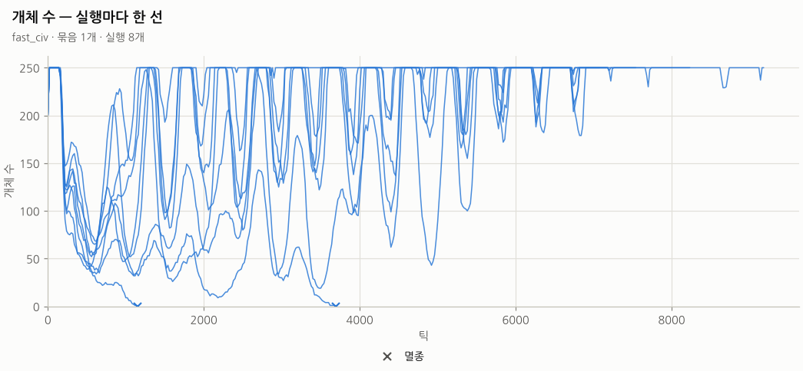
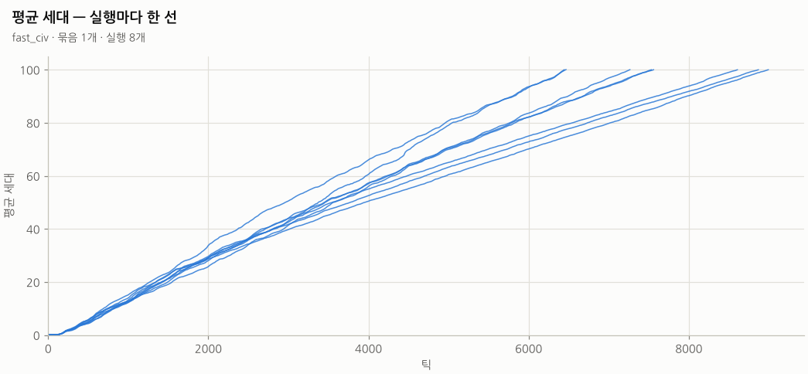
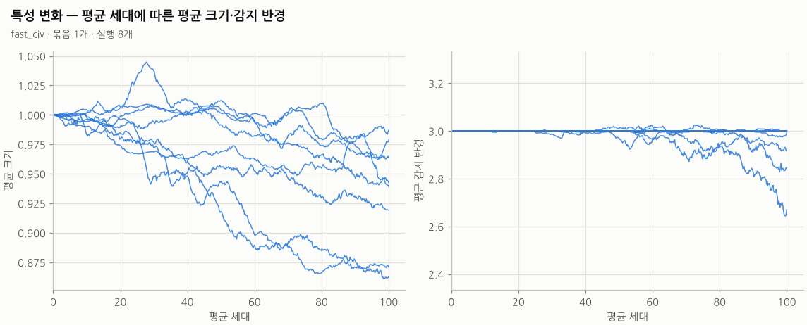
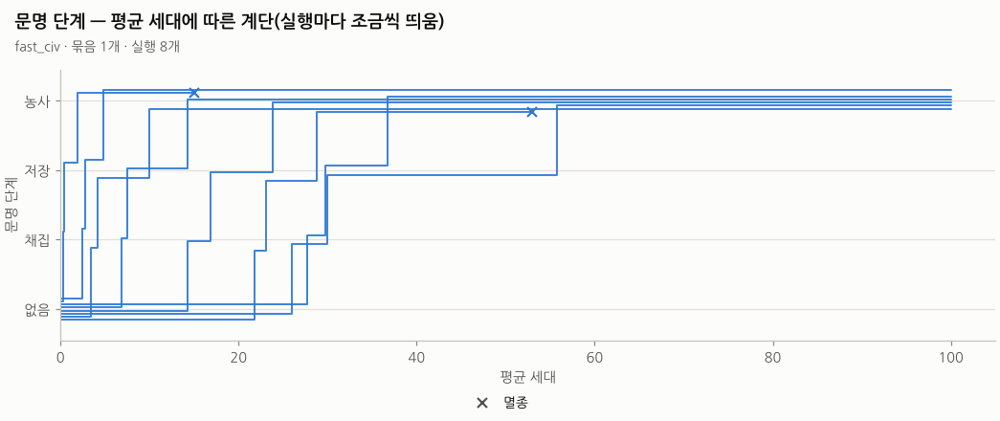
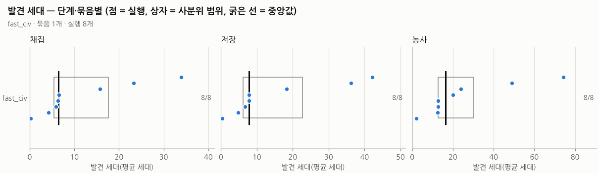

# 실험 분석 보고서

- 결과 폴더: `example-run` — 실행 **8개**, 묶음 **1개**
- 예설정 `fast_civ` · 목표 평균 세대 100.0 · 덮어쓰기 없음
- 표: [`summary.csv`](summary.csv)(실행마다 한 줄), [`cells.csv`](cells.csv)(묶음별 집계). 만든 명령: `python3 tools/analyze.py report <결과 폴더>`

## 묶음별 요약

| 묶음 | 실행 | 멸종 | 채집 도달 | 저장 도달 | 농사 도달 | 끝 평균 세대(중앙값) | 틱(중앙값) | 끝 개체 수(중앙값) | 실행 시간 합(초) |
| --- | ---: | ---: | ---: | ---: | ---: | ---: | ---: | ---: | ---: |
| `fast_civ` | 8 | 25% (2/8) | 100% (8/8) | 100% (8/8) | 100% (8/8) | 100.0 | 7,174 | 250 | 273.5 |

## 발견 세대

도달한 실행만으로 계산한 **중앙값 [Q1–Q3]** (괄호 안 = 도달한 실행/전체). 발견하지 못한 실행은 빠지므로 도달 비율과 함께 읽습니다.

| 묶음 | 채집 | 저장 | 농사 |
| --- | ---: | ---: | ---: |
| `fast_civ` | 10.4 [3.1–22.7] (8/8) | 12.1 [3.6–24.7] (8/8) | 18.9 [8.6–30.6] (8/8) |

## 행동 비율(act/eff)

실행마다 구간의 **고름 비율**(이 행동을 고른 횟수 ÷ 모든 행동 횟수)과 **효과 비율**(효과가 난 횟수 ÷ 모든 행동 횟수)을 내고, 묶음마다 그 **중앙값**을 적습니다(괄호 = 그 구간에 값이 있는 실행 수). 실행마다 구간·행동별 값은 [`actions.csv`](actions.csv).

### 세대 구간별 — 문명 행동이 열린 뒤

구간 = 구간 시작의 평균 세대(10세대 폭). 줍기·내려놓기는 채집, 심기는 농사가 열린 뒤에 시작한 구간만 셉니다.

| 묶음 | 평균 세대 | 줍기 고름 · 효과 %(실행) | 내려놓기 고름 · 효과 %(실행) | 심기 고름 · 효과 %(실행) |
| --- | ---: | ---: | ---: | ---: |
| `fast_civ` | 0–10 | 9.08 · 5.46 (4) | 9.23 · 1.23 (4) | 8.45 · 0.07 (2) |
| `fast_civ` | 10–20 | 8.58 · 4.67 (5) | 6.60 · 0.90 (5) | 7.50 · 0.05 (4) |
| `fast_civ` | 20–30 | 5.21 · 3.03 (7) | 4.25 · 0.35 (7) | 5.01 · 0.02 (5) |
| `fast_civ` | 30–40 | 5.91 · 3.34 (7) | 2.87 · 0.20 (7) | 3.26 · 0.01 (6) |
| `fast_civ` | 40–50 | 5.62 · 2.51 (7) | 1.73 · 0.18 (7) | 2.63 · 0.01 (6) |
| `fast_civ` | 50–60 | 4.12 · 2.24 (7) | 2.64 · 0.13 (7) | 2.57 · 0.01 (7) |
| `fast_civ` | 60–70 | 4.66 · 2.55 (6) | 2.61 · 0.14 (6) | 2.88 · 0.01 (6) |
| `fast_civ` | 70–80 | 5.42 · 2.68 (6) | 2.24 · 0.10 (6) | 2.75 · 0.01 (6) |
| `fast_civ` | 80–90 | 5.89 · 2.94 (6) | 2.03 · 0.10 (6) | 2.14 · 0.00 (6) |
| `fast_civ` | 90–100 | 6.55 · 3.26 (6) | 2.16 · 0.13 (6) | 2.12 · 0.00 (6) |

### 같은 실행의 첫 구간 → 끝 구간

위 표의 묶음 중앙값은 구간마다 값이 있는 실행이 달라(일찍 열린 씨앗만 앞 구간에 있음) 구간끼리의 차이에 씨앗 구성의 차이가 섞입니다. 그래서 실행마다 그 행동의 **첫 구간과 끝 구간**을 견줘 방향을 셉니다: **내린 실행 · 오른 실행 (견준 실행)**. 구간이 하나뿐인 실행은 빠지고, 성공률 = 효과 ÷ 고름입니다.

| 묶음 | 행동 | 고름 내림 · 오름 | 효과 내림 · 오름 | 성공률 내림 · 오름 |
| --- | --- | ---: | ---: | ---: |
| `fast_civ` | 줍기 | 6 · 2 (8) | 6 · 2 (8) | 6 · 2 (8) |
| `fast_civ` | 내려놓기 | 8 · 0 (8) | 7 · 1 (8) | 5 · 3 (8) |
| `fast_civ` | 심기 | 6 · 2 (8) | 6 · 2 (8) | 7 · 1 (8) |

### 틱 구간별 — 처음 1,000틱(열림과 상관없이)

같은 틱에서 묶음을 견주는 표(우연 기준 세계는 수백 틱 만에 멸종할 수 있음). 단계가 열리기 전의 줍기·심기는 효과가 없는 시도라 효과 비율이 0 입니다.

| 묶음 | 틱 | 줍기 고름 · 효과 %(실행) | 내려놓기 고름 · 효과 %(실행) | 심기 고름 · 효과 %(실행) |
| --- | ---: | ---: | ---: | ---: |
| `fast_civ` | 0–200 | 12.53 · 0.00 (8) | 11.84 · 0.00 (8) | 12.20 · 0.00 (8) |
| `fast_civ` | 200–400 | 9.75 · 0.00 (8) | 8.99 · 0.00 (8) | 10.28 · 0.00 (8) |
| `fast_civ` | 400–600 | 8.71 · 0.00 (8) | 8.21 · 0.00 (8) | 9.04 · 0.00 (8) |
| `fast_civ` | 600–800 | 8.19 · 2.07 (8) | 6.56 · 0.42 (8) | 7.90 · 0.00 (8) |
| `fast_civ` | 800–1,000 | 6.96 · 1.89 (8) | 6.64 · 0.40 (8) | 6.56 · 0.00 (8) |

## 실행별 결과

| 묶음 | 씨앗 | 끝난 이유 | 틱 | 평균 세대 | 개체 | 최고 | 단계 | 채집 세대 | 저장 세대 | 농사 세대 | 끝 크기 | 끝 감지 | 시간(초) | 해시 |
| --- | ---: | --- | ---: | ---: | ---: | ---: | --- | ---: | ---: | ---: | ---: | ---: | ---: | --- |
| `fast_civ` | 1 | 멸종 | 3,693 | 53.0 | 0 | 250 | 농사 | 21.70 | 23.02 | 28.53 | 1.01 | 3.00 | 9.4 | `678cb9c1a9fb` |
| `fast_civ` | 2 | 세대 도달 | 9,181 | 100.0 | 250 | 250 | 농사 | 3.31 | 3.97 | 9.91 | 0.96 | 3.00 | 58.9 | `e9d2a3ddcd0c` |
| `fast_civ` | 3 | 세대 도달 | 7,079 | 100.0 | 250 | 250 | 농사 | 25.89 | 29.94 | 55.54 | 0.98 | 3.01 | 38.5 | `23bb2dfee303` |
| `fast_civ` | 4 | 세대 도달 | 7,163 | 100.0 | 250 | 250 | 농사 | 13.97 | 16.87 | 23.64 | 0.97 | 3.00 | 29.4 | `c1ba68485bea` |
| `fast_civ` | 5 | 세대 도달 | 8,234 | 100.0 | 250 | 250 | 농사 | 6.76 | 7.36 | 14.08 | 0.93 | 2.12 | 47.4 | `02e0915bdb18` |
| `fast_civ` | 6 | 세대 도달 | 7,184 | 100.0 | 250 | 250 | 농사 | 27.71 | 29.62 | 36.79 | 0.92 | 3.00 | 39.1 | `12b4bd25617d` |
| `fast_civ` | 7 | 멸종 | 1,153 | 15.0 | 0 | 250 | 농사 | 0.23 | 0.34 | 1.89 | 1.04 | 3.00 | 3.4 | `43ec8ad5deda` |
| `fast_civ` | 8 | 세대 도달 | 7,541 | 100.0 | 250 | 250 | 농사 | 2.28 | 2.50 | 4.75 | 0.89 | 3.00 | 47.5 | `064040229c77` |

## 그림

### 개체 수

실행마다 얇은 선 하나(가로 틱, 세로 살아 있는 개체 수, 묶음 색). 멸종한 실행은 끝에 ×. 개체 수 상한(population.cap)에 붙어 있으면 먹이보다 상한이 개체 수를 정하고 있다는 뜻.

### 평균 세대

틱에 따른 살아 있는 개체의 평균 세대. 기울기 = 세대 교체 속도(세대당 틱의 역수). 크기가 작아지는 진화가 일어나면 후반에 기울기가 바뀐다.

### 특성 변화

가로 평균 세대, 세로 평균 크기(왼쪽)·평균 감지 반경(오른쪽). 대사 비용 압력으로 둘 다 줄어드는지, 묶음(파라미터)마다 다른지 본다.

### 문명 단계

가로 평균 세대, 세로 문명 단계(없음·채집·저장·농사) 계단선. 선이 겹치지 않게 실행마다 세로로 조금씩 띄웠다. 계단이 오른쪽에 있을수록 늦게 발견. 멸종한 실행은 끝에 ×.

### 발견 세대

단계(채집·저장·농사)마다 한 칸. 세로 = 묶음, 점 = 실행 하나의 발견 세대, 회색 상자 = 사분위 범위(실행 3개 이상일 때), 굵은 검은 선 = 중앙값, 오른쪽 숫자 = 도달한 실행/전체 실행.

## 읽는 법

- **발견 세대** = 그 실행의 `chronicle.csv` 에서 `kind = discovery` 인 사건 줄의 `mean_gen`(발견이 일어난 틱에 살아 있던 개체들의 평균 세대, 0.01 단위). 단계는 문장 머리(`채집 발견 — …`)로 가립니다.
- **도달 비율** = 끝날 때 문명 단계(`civ_stage`)가 그 단계 이상인 실행의 비율. **멸종 비율** = 끝난 이유가 멸종인 실행의 비율.
- **끝 평균 세대**: 멸종한 실행은 멸종 직전(살아 있던 마지막 시계열 줄, 최대 기록 간격 20틱 전)의 평균 세대입니다(빈 개체의 평균 0 을 쓰면 중앙값이 내려가 진화가 느린 것처럼 보이므로).
- 사분위는 numpy 기본(선형 보간) 백분위수입니다. 실행이 적으면(씨앗 4개 등) 사분위 범위는 거칠게 읽어야 합니다.
- 실행이 목표 세대에서 멈추므로, 목표보다 늦게 올 발견은 "도달 못 함"으로 보입니다(오른쪽 중도 절단).
- **행동 비율**: 고름 = 그 행동을 고른 횟수 ÷ 그 구간 모든 개체·틱의 행동 수(판단하지 않은 틱의 되풀이 포함), 효과 = 실제로 무언가 바뀐 횟수(DESIGN-v0.2 11.1 — 줍기는 운반이 늘 때, 내려놓기는 운반에서 나갈 때, 심기는 밭이 생길 때) ÷ 같은 분모. 구간은 시계열 줄(기록 간격, 기본 20틱) 단위입니다.
- 같은 씨앗·같은 설정이면 역사 해시가 같습니다(결정성). 해시가 다르면 설정이나 코드가 다릅니다.
