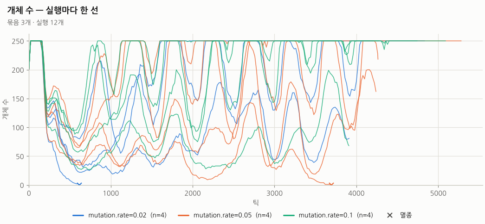
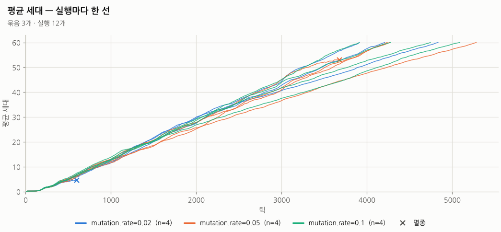
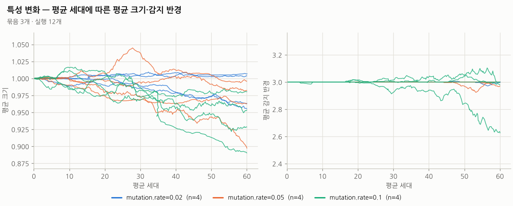
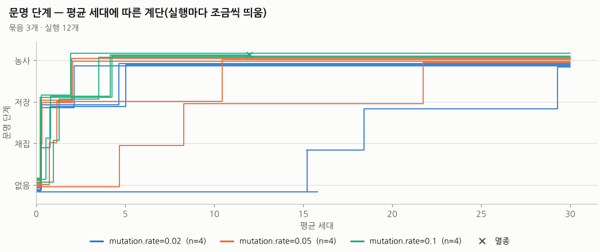

# 실험 분석 보고서

- 결과 폴더: `example-sweep` — 실행 **12개**, 묶음 **3개**
- 예설정 `fast_civ` · 목표 평균 세대 60.0 · 덮어쓰기 묶음마다 다름(`summary.csv` 의 `overrides` 열)
- 표: [`summary.csv`](summary.csv)(실행마다 한 줄), [`cells.csv`](cells.csv)(묶음별 집계). 만든 명령: `python3 tools/analyze.py report <결과 폴더>`

## 묶음별 요약

| 묶음 | 실행 | 멸종 | 채집 도달 | 저장 도달 | 농사 도달 | 끝 평균 세대(중앙값) | 틱(중앙값) | 끝 개체 수(중앙값) | 실행 시간 합(초) |
| --- | ---: | ---: | ---: | ---: | ---: | ---: | ---: | ---: | ---: |
| `mutation.rate=0.02` | 4 | 25% (1/4) | 75% (3/4) | 75% (3/4) | 75% (3/4) | 60.0 | 4,060 | 166 | 59.3 |
| `mutation.rate=0.05` | 4 | 25% (1/4) | 100% (4/4) | 100% (4/4) | 100% (4/4) | 60.0 | 4,252 | 190 | 75.0 |
| `mutation.rate=0.1` | 4 | 0% (0/4) | 100% (4/4) | 100% (4/4) | 100% (4/4) | 60.0 | 4,510 | 250 | 89.1 |

## 발견 세대

도달한 실행만으로 계산한 **중앙값 [Q1–Q3]** (괄호 안 = 도달한 실행/전체). 발견하지 못한 실행은 빠지므로 도달 비율과 함께 읽습니다.

| 묶음 | 채집 | 저장 | 농사 |
| --- | ---: | ---: | ---: |
| `mutation.rate=0.02` | 4.9 [4.5–7.9] (3/4) | 8.4 [6.8–10.1] (3/4) | 16.7 [12.4–19.2] (3/4) |
| `mutation.rate=0.05` | 17.8 [11.3–22.7] (4/4) | 19.9 [13.6–24.8] (4/4) | 26.1 [20.2–35.3] (4/4) |
| `mutation.rate=0.1` | 12.4 [8.2–15.1] (4/4) | 13.1 [8.7–16.6] (4/4) | 20.1 [14.5–24.6] (4/4) |

## 행동 비율(act/eff)

실행마다 구간의 **고름 비율**(이 행동을 고른 횟수 ÷ 모든 행동 횟수)과 **효과 비율**(효과가 난 횟수 ÷ 모든 행동 횟수)을 내고, 묶음마다 그 **중앙값**을 적습니다(괄호 = 그 구간에 값이 있는 실행 수). 실행마다 구간·행동별 값은 [`actions.csv`](actions.csv).

### 세대 구간별 — 문명 행동이 열린 뒤

구간 = 구간 시작의 평균 세대(10세대 폭). 줍기·내려놓기는 채집, 심기는 농사가 열린 뒤에 시작한 구간만 셉니다.

| 묶음 | 평균 세대 | 줍기 고름 · 효과 %(실행) | 내려놓기 고름 · 효과 %(실행) | 심기 고름 · 효과 %(실행) |
| --- | ---: | ---: | ---: | ---: |
| `mutation.rate=0.02` | 0–10 | 10.01 · 5.56 (2) | 6.76 · 0.98 (2) | 7.28 · 0.08 (1) |
| `mutation.rate=0.02` | 10–20 | 9.15 · 5.97 (3) | 8.98 · 1.34 (3) | 6.46 · 0.03 (2) |
| `mutation.rate=0.02` | 20–30 | 10.76 · 6.43 (3) | 6.91 · 1.18 (3) | 5.12 · 0.01 (3) |
| `mutation.rate=0.02` | 30–40 | 10.44 · 6.59 (3) | 5.59 · 1.08 (3) | 3.35 · 0.01 (3) |
| `mutation.rate=0.02` | 40–50 | 10.25 · 6.35 (3) | 4.86 · 0.75 (3) | 4.21 · 0.01 (3) |
| `mutation.rate=0.02` | 50–60 | 10.16 · 6.05 (3) | 3.40 · 0.69 (3) | 2.81 · 0.01 (3) |
| `mutation.rate=0.05` | 0–10 | 7.98 · 4.51 (1) | 9.65 · 1.01 (1) | — |
| `mutation.rate=0.05` | 10–20 | 10.62 · 5.17 (2) | 5.05 · 0.79 (2) | 6.90 · 0.05 (1) |
| `mutation.rate=0.05` | 20–30 | 5.94 · 3.18 (4) | 4.48 · 0.49 (4) | 5.01 · 0.02 (3) |
| `mutation.rate=0.05` | 30–40 | 5.60 · 2.95 (4) | 3.19 · 0.24 (4) | 3.45 · 0.01 (3) |
| `mutation.rate=0.05` | 40–50 | 6.68 · 3.21 (4) | 2.00 · 0.18 (4) | 3.08 · 0.01 (3) |
| `mutation.rate=0.05` | 50–60 | 6.25 · 3.23 (4) | 2.90 · 0.23 (4) | 2.81 · 0.01 (4) |
| `mutation.rate=0.1` | 0–10 | 10.52 · 5.87 (1) | 9.53 · 1.54 (1) | 7.95 · 0.12 (1) |
| `mutation.rate=0.1` | 10–20 | 8.16 · 4.70 (4) | 5.77 · 0.69 (4) | 8.99 · 0.02 (2) |
| `mutation.rate=0.1` | 20–30 | 9.26 · 5.19 (4) | 2.98 · 0.49 (4) | 6.41 · 0.03 (3) |
| `mutation.rate=0.1` | 30–40 | 6.82 · 3.67 (4) | 1.65 · 0.26 (4) | 6.03 · 0.03 (4) |
| `mutation.rate=0.1` | 40–50 | 7.32 · 3.79 (4) | 1.37 · 0.21 (4) | 5.05 · 0.01 (4) |
| `mutation.rate=0.1` | 50–60 | 7.13 · 3.98 (4) | 1.64 · 0.22 (4) | 4.44 · 0.01 (4) |

### 같은 실행의 첫 구간 → 끝 구간

위 표의 묶음 중앙값은 구간마다 값이 있는 실행이 달라(일찍 열린 씨앗만 앞 구간에 있음) 구간끼리의 차이에 씨앗 구성의 차이가 섞입니다. 그래서 실행마다 그 행동의 **첫 구간과 끝 구간**을 견줘 방향을 셉니다: **내린 실행 · 오른 실행 (견준 실행)**. 구간이 하나뿐인 실행은 빠지고, 성공률 = 효과 ÷ 고름입니다.

| 묶음 | 행동 | 고름 내림 · 오름 | 효과 내림 · 오름 | 성공률 내림 · 오름 |
| --- | --- | ---: | ---: | ---: |
| `mutation.rate=0.02` | 줍기 | 1 · 2 (3) | 1 · 2 (3) | 2 · 1 (3) |
| `mutation.rate=0.02` | 내려놓기 | 3 · 0 (3) | 2 · 1 (3) | 1 · 2 (3) |
| `mutation.rate=0.02` | 심기 | 3 · 0 (3) | 2 · 1 (3) | 0 · 3 (3) |
| `mutation.rate=0.05` | 줍기 | 3 · 1 (4) | 3 · 1 (4) | 2 · 2 (4) |
| `mutation.rate=0.05` | 내려놓기 | 4 · 0 (4) | 3 · 1 (4) | 3 · 1 (4) |
| `mutation.rate=0.05` | 심기 | 3 · 0 (3) | 2 · 1 (3) | 2 · 1 (3) |
| `mutation.rate=0.1` | 줍기 | 3 · 1 (4) | 3 · 1 (4) | 1 · 3 (4) |
| `mutation.rate=0.1` | 내려놓기 | 4 · 0 (4) | 4 · 0 (4) | 2 · 2 (4) |
| `mutation.rate=0.1` | 심기 | 4 · 0 (4) | 3 · 1 (4) | 3 · 1 (4) |

### 틱 구간별 — 처음 1,000틱(열림과 상관없이)

같은 틱에서 묶음을 견주는 표(우연 기준 세계는 수백 틱 만에 멸종할 수 있음). 단계가 열리기 전의 줍기·심기는 효과가 없는 시도라 효과 비율이 0 입니다.

| 묶음 | 틱 | 줍기 고름 · 효과 %(실행) | 내려놓기 고름 · 효과 %(실행) | 심기 고름 · 효과 %(실행) |
| --- | ---: | ---: | ---: | ---: |
| `mutation.rate=0.02` | 0–200 | 12.59 · 0.00 (4) | 12.40 · 0.00 (4) | 12.56 · 0.00 (4) |
| `mutation.rate=0.02` | 200–400 | 9.63 · 0.00 (4) | 11.17 · 0.00 (4) | 9.47 · 0.00 (4) |
| `mutation.rate=0.02` | 400–600 | 9.19 · 0.35 (4) | 8.86 · 0.04 (4) | 8.71 · 0.00 (4) |
| `mutation.rate=0.02` | 600–800 | 10.54 · 2.48 (4) | 6.74 · 0.27 (4) | 7.43 · 0.00 (4) |
| `mutation.rate=0.02` | 800–1,000 | 7.61 · 5.18 (3) | 8.12 · 1.11 (3) | 7.33 · 0.00 (3) |
| `mutation.rate=0.05` | 0–200 | 13.01 · 0.00 (4) | 12.24 · 0.00 (4) | 12.53 · 0.00 (4) |
| `mutation.rate=0.05` | 200–400 | 8.19 · 0.00 (4) | 9.60 · 0.00 (4) | 10.81 · 0.00 (4) |
| `mutation.rate=0.05` | 400–600 | 8.12 · 0.00 (4) | 9.26 · 0.00 (4) | 8.27 · 0.00 (4) |
| `mutation.rate=0.05` | 600–800 | 6.67 · 0.00 (4) | 6.14 · 0.00 (4) | 7.24 · 0.00 (4) |
| `mutation.rate=0.05` | 800–1,000 | 6.59 · 0.00 (4) | 6.53 · 0.00 (4) | 6.56 · 0.00 (4) |
| `mutation.rate=0.1` | 0–200 | 12.67 · 0.00 (4) | 11.97 · 0.00 (4) | 12.64 · 0.00 (4) |
| `mutation.rate=0.1` | 200–400 | 10.76 · 0.00 (4) | 9.99 · 0.00 (4) | 9.09 · 0.00 (4) |
| `mutation.rate=0.1` | 400–600 | 9.02 · 0.00 (4) | 8.73 · 0.00 (4) | 8.35 · 0.00 (4) |
| `mutation.rate=0.1` | 600–800 | 8.94 · 0.00 (4) | 8.80 · 0.00 (4) | 6.86 · 0.00 (4) |
| `mutation.rate=0.1` | 800–1,000 | 8.87 · 1.22 (4) | 7.09 · 0.32 (4) | 6.92 · 0.00 (4) |

## 실행별 결과

| 묶음 | 씨앗 | 끝난 이유 | 틱 | 평균 세대 | 개체 | 최고 | 단계 | 채집 세대 | 저장 세대 | 농사 세대 | 끝 크기 | 끝 감지 | 시간(초) | 해시 |
| --- | ---: | --- | ---: | ---: | ---: | ---: | --- | ---: | ---: | ---: | ---: | ---: | ---: | --- |
| `mutation.rate=0.02` | 1 | 멸종 | 618 | 4.5 | 0 | 250 | 없음 | — | — | — | 1.00 | 3.00 | 1.6 | `5dcd614811e6` |
| `mutation.rate=0.02` | 2 | 세대 도달 | 4,834 | 60.0 | 250 | 250 | 농사 | 4.12 | 5.24 | 8.20 | 0.93 | 3.00 | 27.0 | `13c91c6642b4` |
| `mutation.rate=0.02` | 3 | 세대 도달 | 4,208 | 60.0 | 250 | 250 | 농사 | 10.95 | 11.80 | 16.67 | 1.00 | 2.97 | 20.1 | `747431765f42` |
| `mutation.rate=0.02` | 4 | 세대 도달 | 3,912 | 60.0 | 81 | 250 | 농사 | 4.92 | 8.39 | 21.74 | 0.95 | 3.00 | 10.6 | `78cedda04acd` |
| `mutation.rate=0.05` | 1 | 멸종 | 3,693 | 53.0 | 0 | 250 | 농사 | 21.70 | 23.02 | 28.53 | 1.01 | 3.00 | 9.5 | `678cb9c1a9fb` |
| `mutation.rate=0.05` | 2 | 세대 도달 | 5,281 | 60.0 | 250 | 250 | 농사 | 3.31 | 3.97 | 9.91 | 0.97 | 3.00 | 33.1 | `0f6d72bf85a8` |
| `mutation.rate=0.05` | 3 | 세대 도달 | 4,264 | 60.0 | 218 | 250 | 농사 | 25.89 | 29.94 | 55.54 | 1.02 | 3.00 | 21.6 | `ea52faa57075` |
| `mutation.rate=0.05` | 4 | 세대 도달 | 4,239 | 60.0 | 162 | 250 | 농사 | 13.97 | 16.87 | 23.64 | 0.99 | 2.99 | 10.8 | `005dba4e6fb7` |
| `mutation.rate=0.1` | 1 | 세대 도달 | 3,909 | 60.0 | 68 | 250 | 농사 | 18.53 | 21.82 | 33.41 | 0.95 | 3.00 | 10.1 | `8e2cea75ac7b` |
| `mutation.rate=0.1` | 2 | 세대 도달 | 5,090 | 60.0 | 250 | 250 | 농사 | 0.33 | 0.47 | 2.23 | 0.99 | 2.66 | 31.4 | `8fc6899302d4` |
| `mutation.rate=0.1` | 3 | 세대 도달 | 4,277 | 60.0 | 250 | 250 | 농사 | 14.02 | 14.86 | 21.63 | 0.98 | 2.97 | 22.2 | `aaf5eed34dad` |
| `mutation.rate=0.1` | 4 | 세대 도달 | 4,744 | 60.0 | 250 | 250 | 농사 | 10.82 | 11.44 | 18.59 | 0.99 | 2.82 | 25.5 | `86bf1760dcc2` |

## 그림

### 개체 수

실행마다 얇은 선 하나(가로 틱, 세로 살아 있는 개체 수, 묶음 색). 멸종한 실행은 끝에 ×. 개체 수 상한(population.cap)에 붙어 있으면 먹이보다 상한이 개체 수를 정하고 있다는 뜻.

### 평균 세대

틱에 따른 살아 있는 개체의 평균 세대. 기울기 = 세대 교체 속도(세대당 틱의 역수). 크기가 작아지는 진화가 일어나면 후반에 기울기가 바뀐다.

### 특성 변화

가로 평균 세대, 세로 평균 크기(왼쪽)·평균 감지 반경(오른쪽). 대사 비용 압력으로 둘 다 줄어드는지, 묶음(파라미터)마다 다른지 본다.

### 문명 단계

가로 평균 세대, 세로 문명 단계(없음·채집·저장·농사) 계단선. 선이 겹치지 않게 실행마다 세로로 조금씩 띄웠다. 계단이 오른쪽에 있을수록 늦게 발견. 멸종한 실행은 끝에 ×.

### 발견 세대

단계(채집·저장·농사)마다 한 칸. 세로 = 묶음, 점 = 실행 하나의 발견 세대, 회색 상자 = 사분위 범위(실행 3개 이상일 때), 굵은 검은 선 = 중앙값, 오른쪽 숫자 = 도달한 실행/전체 실행.

## 읽는 법

- **발견 세대** = 그 실행의 `chronicle.csv` 에서 `kind = discovery` 인 사건 줄의 `mean_gen`(발견이 일어난 틱에 살아 있던 개체들의 평균 세대, 0.01 단위). 단계는 문장 머리(`채집 발견 — …`)로 가립니다.
- **도달 비율** = 끝날 때 문명 단계(`civ_stage`)가 그 단계 이상인 실행의 비율. **멸종 비율** = 끝난 이유가 멸종인 실행의 비율.
- **끝 평균 세대**: 멸종한 실행은 멸종 직전(살아 있던 마지막 시계열 줄, 최대 기록 간격 20틱 전)의 평균 세대입니다(빈 개체의 평균 0 을 쓰면 중앙값이 내려가 진화가 느린 것처럼 보이므로).
- 사분위는 numpy 기본(선형 보간) 백분위수입니다. 실행이 적으면(씨앗 4개 등) 사분위 범위는 거칠게 읽어야 합니다.
- 실행이 목표 세대에서 멈추므로, 목표보다 늦게 올 발견은 "도달 못 함"으로 보입니다(오른쪽 중도 절단).
- **행동 비율**: 고름 = 그 행동을 고른 횟수 ÷ 그 구간 모든 개체·틱의 행동 수(판단하지 않은 틱의 되풀이 포함), 효과 = 실제로 무언가 바뀐 횟수(DESIGN-v0.2 11.1 — 줍기는 운반이 늘 때, 내려놓기는 운반에서 나갈 때, 심기는 밭이 생길 때) ÷ 같은 분모. 구간은 시계열 줄(기록 간격, 기본 20틱) 단위입니다.
- 같은 씨앗·같은 설정이면 역사 해시가 같습니다(결정성). 해시가 다르면 설정이나 코드가 다릅니다.
